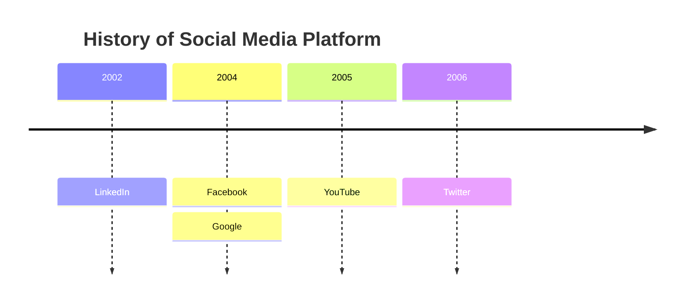
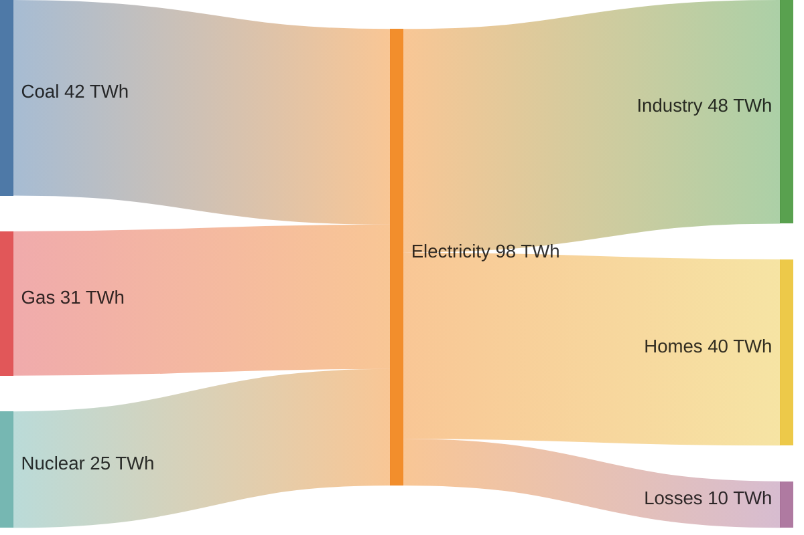

# flowmaid

[](https://github.com/go-routine-id/flowmaid/actions/workflows/ci.yml)
[](https://crates.io/crates/flowmaid)
[](https://docs.rs/flowmaid)
[](LICENSE)

A small Mermaid-like diagram engine written in pure std Rust with zero external dependencies. Takes Mermaid-syntax text and produces SVG — or live, draggable geometry for interactive apps. Twelve diagram types today: flowcharts, ER, UML class, sequence, pie, state, mindmap, user-journey, git graphs, timeline, sankey, and architecture-beta diagrams.

**Website:** https://go-routine-id.github.io/flowmaid/ · **Playground:** https://go-routine-id.github.io/flowmaid-web/ · **Desktop editor:** [flowmaid-desktop](https://github.com/go-routine-id/flowmaid-desktop) · **Terminal:** [flowcli](https://github.com/go-routine-id/flowcli)

## flowmaid next to mermaid

The same `.mmd` source rendered by mermaid 12.2.0 (left, in headless Chromium) and by flowmaid 0.35.0 (right, `flowmaid file.mmd`). flowmaid keeps its own semantic palette by default; mermaid's look is one `--theme default` away (see [Themes](#themes)).

**Flowchart with subgraphs, a decision and a back-edge**


**Loop back to an earlier step**


**UML class diagram**


**State diagram with a composite, a choice, fork/join and a note**


<details>
<summary>More: basic flowchart, nested subgraphs, ER and sequence diagrams</summary>


</details>

Rendering is about **105× faster than mermaid** (geometric mean over 25 diagrams) and the SVG is a fraction of the size — see [Performance](#performance).

## Mermaid parity roadmap

The goal: **mermaid.js functionality, pure-Rust edition.** Progress board with all the details in [issue #10](https://github.com/go-routine-id/flowmaid/issues/10) — contributions welcome, every item has its own issue.

**Targeted mermaid version:** flowchart syntax follows mermaid **12.2.0** (the latest release when this was written); where mermaid 12 changed a default, the difference is noted next to the feature (markdown node labels still wrap at mermaid 11's 200px, not mermaid 12's 120px).

**Diagram types**

- [x] `flowchart` / `graph` — TD/LR/RL/BT, 11 node shapes, 7 link types + labels, chains, fan-out, cycles, self-loops, parallel edges
- [x] `erDiagram` — full crow's foot cardinalities (symbols and mermaid's spelled-out forms), identifying/non-identifying lines, entity attribute tables with key and comment columns, entity aliases, `direction` (top-to-bottom by default, as in mermaid)
- [x] `classDiagram` — three-compartment boxes, member visibility, all UML relations (inheritance/realization/composition/aggregation/association/dependency), cardinalities + labels, notes, `<<stereotypes>>`, generics, `direction`, hierarchy laid out parents-first with orthogonal routes *(v0.9.0)*
- [x] `sequenceDiagram` — participants and stick-figure actors, 8 arrow types, notes, activations, autonumber, loop/opt/alt/par frames, participants mirrored at the bottom *(v0.10.0)*
- [x] `stateDiagram-v2` — `[*]` start/end, composites with nested `[*]`/`direction`, `<<choice>>`/`<<fork>>`/`<<join>>`, transition labels, descriptions, notes *(v0.11.0)*
- [x] `journey` — title/section/task, score-colored smiley faces (1–5) that rise and fall with the score (the satisfaction curve), fractional scores like `3.5`, pale section bands, actor legend + per-task dots with tooltips, long task names wrapped *(v0.14.0)*
- [x] `pie` — title, showData, percentage labels down to 1% (inside the wedge when they fit, else outside on a leader) + legend *(v0.10.0)*
- [x] `mindmap` — indentation-built tree, radial layout with children fanned round their parent and colored branches, seven node shapes (default/square/rounded/circle/hexagon/bang/cloud), `::icon(…)` glyphs, `:::class` (+ mindmap `classDef`) *(v0.13.0)*
- [x] `gitGraph` — LR/TB/BT orientations (mermaid's `gitGraph TB:` form too), commits (`id`, `tag`, `type: NORMAL|REVERSE|HIGHLIGHT`, `msg`), branches (with `order:` to place lanes), checkouts/switches, and merges with ids, tags and types. Each lane has its own colour. Forks and merges are drawn as rounded elbows, merge, REVERSE and HIGHLIGHT commits each get their own glyph, and tags are drawn as luggage labels. Ids are horizontal and measured, so they never collide or get struck by a line *(v0.22.0)*
- [x] `architecture-beta` — nested groups, services, junctions, icons, and port-based edges (`id:L -- R:other`, `-->`, `<-->`, labelled `-[label]-`, mermaid's `{group}` modifier). Services are placed by their ports as in mermaid (`a:R -- L:b` puts `b` to the right), groups never overlap, and edges are routed orthogonally around every box and group title without ever being drawn onto an unrelated edge *(v0.24.0)*
- [x] `sankey-beta` — CSV `source,target,value` rows, quoted fields, node columns by depth, ribbons sized by value, `config.sankey.*` from frontmatter *(v0.29.0)*
- [x] `timeline` — `title`/`section`, `period : event[: event…]` rows, `:`-continuation lines, `LR`/`TD` direction, `%%`/`#` comments, `<br>` and entity folding, bold periods, long periods/events wrapped *(v0.28.1)*
- [ ] The complete mermaid catalog, tracked on the board: `swimlane-beta` · `gantt` · `quadrantChart` · `requirementDiagram` · `C4` · `zenuml` · `xychart` · `block` · `packet` · `kanban` · `radar` · `eventmodeling` · `treemap` · `venn` · `ishikawa` · `wardley` · `cynefin` · `treeview`

**Flowchart features**

- [x] `subgraph` — nesting, titles, per-block `direction`, edges to/from a subgraph *(v0.5.0, v0.7.0)*
- [x] `<br/>` multi-line labels *(v0.7.0)*
- [x] Markdown strings ``"`**bold** _italic_`"`` in node, edge and subgraph labels — real newlines, automatic word wrap for node labels at mermaid 11's 200px width
- [x] `style` / `classDef` / `class` / `:::` custom colors *(v0.4.0)*
- [x] Semantic color theme (shape-based) + stable accent palette shared by ER / class / sequence / pie, with text on accent fills picked for WCAG AA contrast (`style::text_on`)
- [x] Mermaid's themes as options — `default`, `neutral`, `dark`, `forest` — from `SvgOptions::theme`, `--theme`, `%%{init: {"theme": …}}%%` or frontmatter `config: theme:` (plus the main `themeVariables`), for all twelve diagram types; text 4.5:1 and lines 3:1 in every theme
- [x] Interactive scene API — drag nodes, edges re-route live; stable node/edge identity (`SceneNode.id`, `SceneEdge.from`/`to`) and local drag re-routing (`scene`, `route`, `route_partial`, `box_edge_bezier`) *(v0.18.0)*
- [x] Hit-testing / picking — `Scene::{hit_test, node_at, edge_at, cluster_at, hits_in_rect, nearest_node}`, shape-precise, pick-matches-render; completes pick → drag → route for editors *(v0.19.0)*
- [x] Graph → mermaid serializer — `to_mermaid(g)`, the inverse of `parse`: lossless editor round-trip via mermaid entity codes (`#quot;`, `#124;`), valid standard mermaid out; completes pick → drag → route → **persist** *(v0.20.0)*
- [x] `$$math$$` tokenized in labels (Phase A: italic TeX passthrough, correct widths) *(v0.20.0)*
- [x] Compact / serpentine layout — fold a long linear chain into balanced rows to fit a viewport (`fold::scene_compact`, CLI `--compact <px>`) *(v0.18.0)*
- [x] Accessible SVG — `role="img"` + `aria-label` + per-node/edge `<title>`, deterministic byte-identical output *(v0.18.0)*
- [x] `accTitle:` / `accDescr:` / multi-line `accDescr { … }` — the title replaces the SVG's accessible name, the description becomes a `<desc>` with `aria-describedby` (flowchart, state, class, sequence, ER, pie, journey, timeline, architecture; parsed and not yet drawn for gitGraph)
- [x] `flowchart-elk` header — accepted as a `flowchart` alias (flowmaid has one layout engine, so the ELK hint is ignored)
- [x] Injectable font metrics for embedders using a real font (`layout::intrinsic_size_with` / `intrinsic_size_wrapped`, `scene::scene_sized_with`, `TEXT_CALIBRATION`) *(v0.18.0)*
- [x] Explicit "not supported yet" errors for every known mermaid header
- [ ] `$$…$$` math in labels, KaTeX-style — Phase A passthrough ✅ v0.20.0; next: MathML subset → native — [#12](https://github.com/go-routine-id/flowmaid/issues/12)
- [x] Fan-out `A --> B & C`, inline `-- text -->` labels, `-.-`/`===` open lines, `~~~` invisible links *(v0.6.0)*
- [x] Edge markers: cross `--x`, circle `--o`, two-way `<-->` / `x--x` / `o--o` on solid, dotted and thick lines
- [x] Edge ids and metadata — `A e1@--> B`, then `e1@{ animate: true }`, `e1@{ animation: slow }`, `e1@{ curve: linear }` (all thirteen mermaid curve names); ids become `id="flowmaid-<hash>-e1"` / `data-id="e1"` (namespaced per SVG like mermaid's), animation is mermaid's CSS dash animation, scoped to the SVG
- [x] More node shapes — cylinder `[( )]`, subroutine `[[ ]]`, hexagon `{{ }}`, parallelograms `[/ /]` `[\ \]`, double circle `((( )))` *(v0.8.0)*; trapezoids `[/ \]` `[\ /]` and asymmetric `>text]` as look-alikes
- [x] Mermaid v11 node metadata `A@{ shape: cyl, label: "DB" }` — every registry shape name accepted (exact geometry for 15 families, nearest look-alike for the rest), mermaid's exact "No such shape" errors, one-line and multi-line YAML forms
- [x] `linkStyle <n>[,<n>…]` / `linkStyle default`, with optional `interpolate <curve>` — per-edge stroke, width, dash, fill and label colour; arrow, cross and circle markers take the stroke colour
- [x] `click` — `href` links with tooltips and `_self`/`_blank`/`_parent`/`_top` targets wrap the node in an SVG `<a>`; urls are sanitised like mermaid's default `strict` level; callbacks parse and are ignored (static SVG runs no script)
- [ ] `$$math$$` — see the board

**Why flowmaid?** Zero dependencies, `wasm32` out of the box (all twelve diagram types fit in a compact wasm bundle — mermaid.js is ~2.5 MB), sub-millisecond renders, line-numbered parse errors, and one geometry source shared by SVG export and interactive canvases. Input is forgiving where it should be: UTF-8 BOMs are stripped, CRLF is fine, and every known-but-unsupported Mermaid header fails with an explicit message instead of a confusing parse error.

## Installation

```bash
cargo add flowmaid
```

Or in `Cargo.toml`:

```toml
[dependencies]
flowmaid = "0.35"
```

## Usage

```bash
cargo build --release

# from a file
./target/release/flowmaid examples/demo.mmd -o demo.svg

# or through a pipe
cat examples/lr.mmd | ./target/release/flowmaid > lr.svg

# fold a long linear chain to fit 300 px along the flow axis
./target/release/flowmaid examples/lr.mmd --compact 300 -o lr-compact.svg

# drop the canvas background so the SVG sits on any page colour
# (combines with --compact, --advance and --advance-text)
./target/release/flowmaid examples/demo.mmd --transparent -o demo.svg

# paint in one of mermaid's themes: default, neutral, dark or forest
# (flowmaid, the default, is the semantic palette); beats a theme the
# source names, which applies otherwise
./target/release/flowmaid examples/demo.mmd --theme neutral -o demo.svg

# during development
cargo run -- examples/demo.mmd -o demo.svg
cargo test
```

It also works as a library (the crate is lib + bin) — one call, any supported diagram type, dispatched on the header:

```rust
let flow = flowmaid::render_svg("flowchart TD\nA[Start] --> B[Done]")?;
let uml  = flowmaid::render_svg("classDiagram\nAnimal <|-- Dog")?;
let fsm  = flowmaid::render_svg("stateDiagram-v2\n[*] --> Idle")?;
```

Rendering options go through `SvgOptions` and `render_svg_advanced` (each diagram module also has a `*_with` writer). `SvgOptions` is `#[non_exhaustive]`: start from `Default` and set the fields you need — that is the supported way to build it, and it keeps compiling as options are added:

```rust
let mut opts = flowmaid::SvgOptions::default();
opts.transparent = true; // no white canvas rect — same as CLI --transparent
opts.responsive = true;  // width="100%" instead of a fixed pixel size
let svg = flowmaid::render_svg_advanced("flowchart TD\nA --> B", &opts)?;
```

Transparent output keeps the theme's text and edge colours: on a dark page, pick the dark theme too.

### Themes

flowmaid's own palette — nodes coloured by shape, class / ER / sequence items in an accent each — is the default and does not change. Mermaid's looks are options, set from code, the CLI or the diagram itself:

| theme | `Theme::` | look |
|---|---|---|
| `flowmaid` (default) | `Flowmaid` | semantic palette: stadium green, diamond amber, …; an accent per class, entity and participant |
| `default` | `Mermaid` | mermaid's default: lavender `#ececff` nodes with a `#9370db` border, `#333333` lines and text, pale yellow frames |
| `neutral` | `Neutral` | white nodes, one `#333333` ink for borders, lines and text, grey frames |
| `dark` | `Dark` | light text, lines and borders on a near-black `#1e1f22` canvas |
| `forest` | `Forest` | green `#cde498` nodes with a deep green border, black lines |

```rust
use flowmaid::style::Theme;
let mut opts = flowmaid::SvgOptions::default();
opts.theme = Some(Theme::Dark);
let svg = flowmaid::render_svg_advanced("flowchart TD\nA --> B", &opts)?;
```

A diagram can name its theme the way mermaid reads it — `%%{init: {"theme": "neutral"}}%%` (or `%%{initialize: …}%%`, on one line or several) or `theme:` under a YAML frontmatter's `config:` — and `render_svg` / `render_svg_advanced` honour it; the directive wins over the frontmatter, as in mermaid. Its `themeVariables` `background`, `primaryColor` (node fill), `primaryBorderColor`, `primaryTextColor`, `lineColor` and `textColor` recolour those roles; other variables are ignored. An unknown theme name is the default theme, without error (mermaid does the same); `base` reads as `default`, `neo` as `neutral`, `neo-dark` as `dark`. **An explicit `SvgOptions::theme` (or `--theme`) beats the source** — its theme name and variables alike — so `Some(Theme::Flowmaid)` renders a themed file in flowmaid's colours. If you parse first and render through a `render::*_with` writer, call `opts.with_source_theme(source)` to honour the source's theme as the CLI does.

Every theme applies to all twelve diagram types: flowchart and state nodes, frames (still a shade deeper per nesting level), edges, arrowheads, labels and notes; class boxes, ER tables and sequence participants take the theme's node paint, as mermaid draws them; the charts (pie, journey, timeline, git graph, sankey, mindmap, architecture) keep their categorical colours while their text, lines and canvas follow the theme. Every theme keeps text at 4.5:1 and lines and borders at 3:1 on what they are drawn over — the dark one included, where mermaid's own frame borders and label chips fall short. `style`, `classDef` and `linkStyle` colours always win over the theme; a `style` fill without a `color` gets text that reads on it when the theme's ink would not. Hosts painting a `Scene` get the exact colours from `opts.palette()` (`style::Palette`). Marker ids carry a non-default edge colour, so diagrams of different themes can share a page.

## Supported syntax

The header sets the flow direction: `flowchart TD` (top-down, alias `TB`), `LR` (left-right), `RL`, or `BT`. The keywords `graph` and `flowchart-elk` are also accepted; `flowchart-elk` asks mermaid for its ELK layout engine, and flowmaid, which has a single layout, treats it as plain `flowchart`. Lines starting with `%%` are comments, and `;` separates multiple statements on one line.

Accessibility statements follow mermaid: `accTitle: text` replaces the SVG's accessible name (`<title>` and `aria-label`, default "Flowchart diagram"), and `accDescr: text` or a multi-line `accDescr { … }` block adds a `<desc>` that the root `aria-describedby` points at (its id is a content hash, so inlined SVGs never collide). As in mermaid the value runs to the end of the line (`;` and `%%` included), the keywords are case-sensitive, the last statement wins, and a block's continuation indentation and blank lines fold away. They work in state, class, sequence, ER, pie, journey, timeline and architecture diagrams too. An unclosed `accDescr {` is a line-numbered error (mermaid swallows the rest of the file). Inside a multi-line markdown string or `@{ … }` block the keywords are plain label / YAML text, as in mermaid; after one closes, a statement can follow a `;` on the same line.

Node shapes: `A[text]` rectangle, `A(text)` rounded, `A([text])` stadium, `A{text}` diamond, `A((text))` circle, `A(((text)))` double circle, `A[(text)]` cylinder (database), `A[[text]]` subroutine, `A{{text}}` hexagon, `A[/text/]` and `A[\text\]` parallelograms; the trapezoids `A[/text\]` and `A[\text/]` and the asymmetric `A>text]` parse too and draw as the same nearest look-alikes as their `@{ shape: … }` names below. Mermaid v11 node metadata works too: `A@{ shape: cyl, label: "DB" }`, glued after the id (and after any bracket shape or `:::class`, which it overrides), on one line or spread over several (YAML block form, `label: |` / `label: >` block scalars read like js-yaml — a folded line indented past the rest keeps its own line, and a line indented less than the first is an error — a quoted value broken across lines becomes a line break). Every name in mermaid's shape registry is accepted: `rect`, `rounded`, `stadium`, `fr-rect`, `cyl`, `circle`, `dbl-circ`, `diam`, `hex`, `lean-r`, `lean-l`, `sm-circ`, `fr-circ`, `fork`, `f-circ` and their aliases draw their exact flowmaid shape; names flowmaid has no geometry for yet (`doc`, `trap-b`, `cloud`, `delay`, `tri`, …) draw the nearest look-alike, and `text` / braces / `bolt` draw without a box. An unknown name, or one with uppercase or `_`, fails with mermaid's own "No such shape" message. As in mermaid 12, a metadata `label` is markdown — `A@{ label: "**b** _i_" }` is bold and italic and wraps like a ``"`…`"`` label — unless `labelType: string` or `labelType: text` keeps it plain. `icon`, `img`, `form`, `pos`, `w`, `h` and `constraint` are accepted but not drawn (an icon/image node keeps its id as its label). The block ends at its first `}`, as in mermaid's lexer, so a nested `{…}` value is an error — quote it. Labels may be quoted to protect special characters (`A["odd [text]"]`) and use `<br/>` for line breaks. A node label that breaks none of its own lines wraps at 200px (mermaid's `flowchart.wrappingWidth` default) — in flowcharts and state diagrams alike — at its spaces and between CJK characters into as few lines as fit, evened out so no word is left alone on the last line; `<b>` / `<i>` markup wraps too, re-opened on each line. A word is never split: one wider than the width keeps its line, and a lone word beside it joins it. Diamonds and circles, which grow both ways with their text, wrap at the width / 1.6 (a rhombus is 1.6× as wide as its text): a long question wraps into a diamond no flatter than 1.6:1, while a short one keeps its compact one-line diamond. A label with a `<br/>` keeps exactly the lines it was written with. Set the width with `%%{init: {"flowchart": {"wrappingWidth": 120}}}%%` or `wrappingWidth: 120` under `config.flowchart` in the frontmatter (120 is what mermaid 12.2 draws node labels at); embedders call `Graph::set_wrapping_width` (`None` = never wrap), size nodes with `layout::intrinsic_size_wrapped(node, g.wrapping_width(), measure)` and pass the same `measure` to `scene::scene_sized_with` / `scene::route_sized_with`, so the scene's label lines are the ones their boxes were sized for (`scene_sized` / `route_sized` break lines with the built-in estimate). The wrap is layout only: the model's label and `to_mermaid` keep a plain label as written, and the scene's node label carries the drawn lines. Markdown strings work as in mermaid: a label written as ``"`…`"`` (a quote directly followed by a backtick) takes `**bold**` / `__bold__`, `*italic*` / `_italic_` (CommonMark's flanking rules, so `snake_case` and `2 * 3` stay plain) and backslash escapes, and may span several lines; a newline is a line break (its indentation dropped), blank lines count once, and `<br/>` still breaks. Other markdown (headings, lists, links, code, strikethrough) shows as written, which is what mermaid's default HTML labels do. Markdown node labels wrap the same way at the same width (a fixed 175px before), each of their lines on its own, as they are lowered: `Node::label` holds the broken lines, while `to_mermaid` writes the markdown back as written and `Graph::set_wrapping_width` lowers it again at the new width. Edge labels and subgraph titles are styled but stay on one line. A bare ``subgraph "`**Two**`"`` takes the markdown text as its id, like mermaid. A raw backtick or `"` inside the string is a line-numbered error (write `#96;` / `#quot;`), and ``"``"`` is an empty label (mermaid rejects it). Entity codes in the text never act as markdown (`#42;` is a literal `*`). Labels are lowered to flowmaid's `<b>` / `<i>` / newline markup at parse time, so the wrap uses the built-in width estimate even when an embedder supplies real font metrics. Mermaid entity codes are decoded in every label position (`#quot;` → `"`, decimal `#65;` → `A`) — since v0.20.0, matching mermaid.js; control characters are refused.

Edges: `-->` arrow, `---` open line, `-.->` dotted (drawn as dots, `stroke-dasharray="2 3"` at the default width, scaled with a `linkStyle` width), `-.-` dotted open, `==>` thick, `===` thick open, and `~~~` invisible links that shape the layout without being drawn. Labels come in both mermaid spellings — `-->|text|` and inline `-- text -->` (`-. text .-`, `== text ==>`). Cross and circle ends (`--x`, `-.-x`, `==x`, `--o`, `-.-o`, `==o`, also `-- text --x`) and two-way links (`<-->`, `<-.->`, `<==>`, `x--x`, `o--o`, also `<-- text -->`) draw the matching glyph at each end. As in mermaid, a marker letter glued to the operator is the marker: `A---oB` is a circle edge to `B` — write `A --- oB` to target a node named `oB`. Fan-out lists work on either side: `A --> B & C`, `A & B --> C`. An edge can carry an id written before its operator — `A e1@--> B`, `A e1@-- text --> B`, `A e1@x--x B` — which the SVG writes as `id="flowmaid-<hash>-e1" data-id="e1"` — mermaid's `<diagram-id>-<edge-id>`, with a content-hashed, deterministic diagram id that the root `<svg>` carries (only when the diagram has edge ids or animation), so several SVGs inlined on one page never share an edge id. A later `e1@{ … }` statement sets its metadata, mermaid-style: `animate: true` (or `animation: fast` / `slow`) adds mermaid's `edge-animation-*` class plus its dash-animation CSS, scoped to that SVG (`#flowmaid-<hash> .edge-animation-fast`, keyframes `flowmaid-<hash>-dash`) so it never restyles the host page, and `curve:` picks the path shape (`basis` default, `linear`, `rounded`, `step`, `stepBefore`, `stepAfter`, `bumpX`, `bumpY`, and `natural` / `monotoneX` / `monotoneY` / `cardinal` / `catmullRom`, which flowmaid draws as one Catmull-Rom spline; an unknown name means `basis`). The block may span lines (YAML block form). As in mermaid, with fan-out only the last-source → first-target pair takes the id, a repeated id is silently dropped, and metadata written before its edge exists is a node. Chains like `A --> B & C --> D` are supported, as are cycles (`E --> B` looping back up) and self-loops (`A --> A`).

Subgraphs use mermaid's block syntax — `subgraph id [Title]` … `end` — with arbitrary nesting and an optional `direction LR` line per block (inherited from the parent otherwise). A block's `direction` follows mermaid's rule: it holds while none of the block's nodes links to a node outside it — edges to or from the block itself (`X --> s`, `s --> Y`) are fine — and the block is then laid out on its own, in its direction, and placed in the drawing round it like one node, edges to it meeting its frame (`flowchart TB` with `subgraph s` / `direction LR` / `A --> B --> C` draws A, B and C in a row, mermaid's documentation example of nested `TB` / `RL` / `BT` blocks too). Once a member links out (`A --> X`, or a member to its own block, `C --> s`), or an edge reaches into a block nested in it, the block takes the direction round it, as in mermaid. Members with no links among them already lie in one row across the flow, the row a direction across the flow asks for. A node mentioned inside a block is claimed by it, mermaid-style, even if it first appeared elsewhere — unless a block that already closed holds it: as in mermaid, the first block to close keeps a node, so mentioning a nested block's node again in the outer block after the nested `end` leaves it where it is. Edges may freely cross cluster borders, and an edge may target a subgraph *itself* (`CF --> VPC`) — it attaches to the cluster box and ranks it after (or before) the other end; forward references (edge before the block) work via a pre-scan. An edge from a member to its own enclosing box (`Dev --> CI` with `Dev` inside `CI`) cannot reach the box from inside it: it is drawn to the box's entry member (the first member nothing inside the box leads to) and ranks the node before it. Each nesting depth draws its frame a step deeper in a cool grey, with a border that reads on the canvas and on the frame round it (`style::cluster_style(depth)`, `style::CLUSTER_TITLE` for hosts that paint frames themselves). See `examples/subgraph.mmd`.

Edges are styled with mermaid's `linkStyle`: `linkStyle 3 stroke:#ff3,stroke-width:4px,color:red` styles the fourth link, `linkStyle 1,2,7 color:blue` several (no spaces in the list), and `linkStyle default …` every link, including ones defined later. Indices count every link in source order, as mermaid does: each pair of a fan-out (`A & B --> C & D` is A-C, A-D, B-C, B-D), invisible `~~~` links, and links to a subgraph; an index past the links defined so far is mermaid's line-numbered "out of bounds" error. Properties: `stroke` (the arrow, cross and circle markers take the same colour), `stroke-width` (0 to 1000px; up to about 6px the arrowhead keeps its normal size, as in mermaid — every end glyph is 11px, a thick `==>` edge included; under a stroke wider than half a head the line stops its own width short, its head set further ahead in an `arrow-t<width>` marker, and a stroke over about 6px gets a head grown to hold it, `width + width/4 + width/2` px long (`1.5` px for the middle term up to a 6px stroke), in an `arrow-t<width>-s<length>` marker, so even a very wide line ends inside its head, its tip on the node border — where the line turns too hard just before its node for a straight run that long, the head turns with it, facing along the chord into the end; where arrowheads stand side by side closer than a head apart, as on a crowded side, they are drawn narrower, in an `arrow-w<width>` marker, so they never run together), `stroke-dasharray` (`5 5`; `0` makes a dotted edge solid), `fill` and `color` (edge label text); unknown properties are ignored, and so is the bare `5` mermaid splits off `stroke-dasharray:5,5`. A later `linkStyle` for the same index replaces the earlier one; the default and an index style merge per property, the index winning. `linkStyle <n> interpolate <curve>` (with or without styles) sets the curve, using the same names as `curve:` above; an `e1@{ curve: … }` on the same edge wins. A `~~~` link stays hidden unless its style sets a positive `stroke-width`, as in mermaid, and never gets markers. Two deliberate differences from mermaid: when both the default and an index style set `stroke`, the markers follow the colour the line is drawn in (mermaid takes the default's), and a circle marker is filled as well as outlined in the edge colour (mermaid colours only its outline).

Links use mermaid's `click` statement: `click A "https://example.com"`, `click A href "https://example.com" "Tooltip" _blank` (url, then optional tooltip, then optional `_self` / `_blank` / `_parent` / `_top`, in that order), and `click A,B "url"` for several nodes. The SVG wraps the node in `<a href=… xlink:href=…>` (with `rel="noopener noreferrer"` on `_blank`; no `target` means the same tab, as in mermaid), and a tooltip becomes the node's `<title>`. Urls are checked like mermaid's default `strict` security level (a port of `@braintree/sanitize-url`): after decoding percent escapes, HTML and mermaid entities and dropping control and invisible characters, a `javascript:`, `data:` or `vbscript:` url is not linked at all (mermaid would write `about:blank`); relative, scheme-less, `mailto:`, `https:` and other urls stay exactly as written. Callbacks (`click A callback`, `click A call fn(args) "tooltip"`) are accepted for compatibility and ignored, since a static SVG runs no script, but their tooltip still applies. As in mermaid, a link only lands on a node that already exists: an unknown id, a subgraph or edge id, or a node declared further down is ignored without creating a node, while a tooltip reaches a node declared later. Keywords are case-sensitive (`Click A` is a node), and flowmaid is lenient about extra spaces (`click A  href  "u"`), which mermaid rejects. Scene consumers get the link and tooltip on `SceneNode::link`.

Custom colors use mermaid's styling syntax: `style A fill:#f9f,stroke:#333,stroke-width:4px,color:#fff`, reusable classes via `classDef hot fill:#ffe3e3,stroke:#e03131` + `class A,B hot` or the inline shorthand `A:::hot`, and `classDef default …` styles every node, as in mermaid (a node's own classes and `style` lines win per property; a borderless `text` shape takes only its colour). Supported properties: `fill`, `stroke`, `stroke-width` (0 to 1000px; a cylinder's lid, a subroutine's bars and a final state's ring take it too), `color` (label text); unknown properties are ignored, and so is a bare item after a property (mermaid splits values on every comma, so `stroke-dasharray: 9,5` leaves a stray `5`); a statement starting with a bare item is an error. Unstyled nodes fall back to a semantic theme — shape determines color (stadium green, diamond amber, circle violet, ...; see the `style` module) — and ER entities cycle through a stable accent palette; a [theme](#themes) paints them in mermaid's colours instead.

Complete examples live in `examples/` — `demo.mmd` and `lr.mmd` for the basics, `advanced.mmd` for everything at once (nested subgraphs, all shapes and link types, `<br/>`, custom colors), plus one showcase per diagram type (`er`, `class`, `sequence`, `pie`, `state`).

## Entity-Relationship diagrams

`erDiagram` input renders entities as attribute tables connected with crow's foot notation:

```
erDiagram
    users ||--o{ posts : "writes"
    users {
        uuid id PK "default gen_random_uuid()"
        varchar(255) email UK "not null"
    }
```

Supported subset:
- **Cardinalities:** all crow's foot cardinalities, as symbols (`||` exactly one, `|o`/`o|` zero or one, `}o`/`o{` zero or many, `}|`/`|{` one or many; any symbol works on either side) or spelled out the way mermaid spells them (`only one`, `zero or one`, `one or more`, `zero or more`, `1`, `1+`, `0+`, `many(0)`, `many(1)`, …).
- **Lines:** identifying (`--` or `to`, solid) and non-identifying (`..`, `.-`, `-.` or `optionally to`, dashed).
- **Labels:** optional relationship labels. A label is kept clear of the crow's feet, and the layout leaves room for both glyphs and the label on a short line.
- **Entity blocks:** rows of the form `type name [PK|FK|UK] ["comment"]`. Several rows may share a line, and a whole block may fit on one (`A { int id PK "key" string name }`, `B {}`). Key lists may be written in any case (`pk, fk`). Types with parentheses (`varchar(255)`) and comments containing commas, parentheses or quotes are handled.
- **Comments:** comments are drawn in their own muted, italic column after the keys. One wider than 280px is cut with an ellipsis and keeps its full text as a tooltip.
- **Entities:** names may be quoted (`"Customer Account"`). An alias (`p[Person]`, `c["Customer Account"]`) replaces the name in the header. Mermaid accepts an alias only where an entity is declared; flowmaid also accepts one inside a relationship. Entities mentioned only in relationships render as title-only tables.
- **Layout:** `direction TB|BT|LR|RL` sets the flow; the default is top to bottom, as in mermaid. A relationship that closes a cycle is drawn as a plain line rather than a bow.

See `examples/er.mmd`.

## Class diagrams

`classDiagram` input renders UML classes as three-compartment boxes (name / fields / methods) connected with UML relationship glyphs:

```
classDiagram
    class Animal {
        +String name
        -int age
        +move() void
    }
    Animal <|-- Dog
    Animal "1" o-- "*" Toy : owns
    Dog "1" --> "*" Toy : plays with
    Cat ..> Toy : ignores
```

Supported subset:

- **Members.** Class blocks with `+ - # ~` member visibility. A member with `()` becomes a method, otherwise a field. Inline members work via `Name : +member`, and `class Duck, Fish` declares several classes on one line. Members read as mermaid shows them: a method's return type follows `" : "` (`+total() : Money`), `~T~` generics read `<T>`, and a `$` or `*` classifier draws the row underlined (static) or in italics (abstract).
- **Generics.** `class Box~T~` is one class `Box`, shown as `Box<T>`.
- **Names.** As in mermaid, a class name may hold hyphens, also in relations and notes (`Animal-Name --> Dog`, `A-B --> C-D`); `--` and `..` are always operators, so `A--B` links `A` to `B` and `A- --> B` names the class `A-`. A backtick name is taken literally, without its backticks, so it may hold spaces or operators: `` `Foo Bar` --> Baz `` (`` `Foo` `` is the class `Foo`).
- **Stereotypes.** `<<interface>>` (or any `<<x>>`) inside a block, or on its own line as `<<interface>> Name`, draws as `«interface»` above the name.
- **Relations.** All UML relations are supported: inheritance `<|--`, realization `..|>`, composition `*--`, aggregation `o--`, association `-->`, dependency `..>`, and plain link `--`/`..`, in either direction. As in mermaid, any end glyph goes on either line (`*..` is a dashed composition). Each relation takes optional `"cardinality"` strings on each side (a colon or operator inside the quotes is protected) and a `: label`.
- **Two-way relations.** A glyph on both ends draws one at each end: `Animal <|--|> Zebra`, `A *--* B`, `A o--o B`, `A <--> B`, `A <..> B`, `A <|..|> B`, and mixed ends such as `A *--> B` or `C o..|> D`. Cardinalities and labels work as on any relation.
- **Lollipop interfaces.** `bar ()-- foo` and `foo --() bar` draw the interface `bar` as its name alone, with a small circle where its line meets it (`()..` for a dashed line). As in mermaid, each lollipop line makes its own interface, separate from any class of the same name. A lollipop facing another glyph (`A ()--* B`) joins two classes, with a circle at that end.
- **Layout.** As in mermaid, relations are laid out in source order, with the left operand first. In `Animal <|-- Dog`, the parent sits above its child (with `direction LR` it sits to the left, and `TB`, `BT` and `RL` work too), and in `Animal <|--|> Zebra` or `bar ()-- foo` the left operand leads too. The end glyph (hollow triangle, filled or hollow diamond, open arrow or lollipop circle) sits at the decorated end. Realization and dependency use dashed lines.
- **Routing.** Edges are orthogonal with rounded corners, square to the box faces and clear of the corners. An orthogonal route never runs along another edge (where no lane is free, the edge keeps a curve), and the end glyphs on one face sit apart. A fan's jogs nest in order, and a fan wider than its parent's face sends its outermost legs to the side faces, so a class with up to about a dozen subclasses draws its fan without a crossing. Crowded fan-ins (six or more classes pointing at one) can still cross, up to about a dozen times with labels and cardinalities, and much wider fans (twenty or more subclasses) many times, a leg with no free lane keeping a diagonal curve across the others. Cardinalities sit beside their end, clear of lines, glyphs and labels, in every direction. A class's self-relations alternate sides and nest, those with cardinalities outermost so each cardinality sits by its own end. They move to a clear face when a sibling sits close (past four loops on such a class, a loop can still pass under the sibling), and their labels sit beside the loops, not on them.
- **Notes.** `note "text"` and `note for Class "text"` draw as yellow cards, and an attached note sits just above its class, linked to it by a dotted line. `\n` or `<br/>` breaks a note line. A diagram may hold notes alone. As in mermaid, a note for a class that is never declared stays free.
- **Comments.** Trailing `%%` comments are stripped (mermaid prints them as part of the label).
- **Not yet supported:** `namespace` blocks, `classDef` / `:::` styling and `click` in class diagrams; dotted names in relations (`A.B --> C`), which are parse errors.

See `examples/class.mmd`.

## Sequence diagrams

`sequenceDiagram` input renders participant boxes across the top (repeated below the lifelines, as mermaid's `mirrorActors` does), dashed lifelines between them, and one row per statement top-down:

```
sequenceDiagram
    autonumber
    actor U as User
    participant API
    U->>+API: GET /profile
    API-->>-U: 200 OK
    Note over U,API: cached for 60s
    loop every minute
        API->>API: refresh token
    end
```

Supported subset:

- **Participants.** `participant` / `actor` declarations with `as` aliases. Actors draw as UML stick figures with their name below. Implicit participants are created on first mention, in order of appearance.
- **Messages.** All eight arrows: `->>` solid with a filled head, `-->>` dashed with a filled head, `->` / `-->` plain lines without a head, `-x` / `--x` cross ends, and `-)` / `--)` async open arrows. Self-messages (`A->>A:`) draw as a loop beside the lifeline. `autonumber` adds bold `1.` prefixes.
- **Notes.** All four forms: `Note over A,B:`, `Note over A:`, `Note left of A:` and `Note right of A:`. The keywords are case-insensitive.
- **Activation bars.** Use `activate` / `deactivate` or the `+`/`-` arrow shorthand (`A->>+B:` activates B, `B-->>-A:` deactivates B). Both forms start and end the bar at the message they belong to, and arrows stop at the bar's edge. Unbalanced deactivation is a line-numbered error.
- **Frames.** `loop` / `opt` / `alt`+`else` / `par`+`and` draw as labelled boxes with dashed dividers. Each frame's conditions share one column next to its chip. By default, frames are aligned full-width bands that widen to contain their notes. Frontmatter `config: sequence: scopedFrames: true` (a flowmaid key, which mermaid ignores) sizes each frame to the lifelines it covers, as mermaid does.
- **Config.** Frontmatter `config: sequence: mirrorActors: false` drops the participant row at the bottom.
- **Comments.** Trailing `%%` comments are stripped. This deliberately differs from mermaid 12, which prints them as part of the message text.
- **Limitations.** Message and note text is single-line (`<br/>` collapses to a space). `box`, `rect`, `critical`, `break`, `create`/`destroy` and `autonumber` arguments produce an explicit "not supported yet" error.

See `examples/sequence.mmd`.

## Pie charts

`pie` input renders proportional slices (clockwise from 12 o'clock, in source order) with percentage labels and a color legend:

```
pie showData
    title Key elements in Product X
    "Calcium" : 42.96
    "Potassium" : 50.05
    "Magnesium" : 10.01
    "Iron" : 6
```

Supported subset: all header forms (`pie`, `pie showData`, `pie title …`, `pie showData title …`), a standalone `title …` line, and `"Quoted Label" : value` data rows with non-negative numbers. `showData` appends the raw value to each legend entry (`Calcium [42.96]`). Every slice of at least 1% gets a percentage label, as in mermaid: inside its wedge when the text fits there, otherwise just outside the rim on a short leader line (thinner slices keep their legend row). Percentages round halves up like mermaid's `toFixed(0)`. Zero-value slices are legend-only, a single 100% slice renders as a full circle, and an all-zero total draws an empty outline instead of NaN geometry. A duplicate label keeps one slice — the last value wins. Colors come from the same stable accent palette as ER/class diagrams, extended to sixteen colours before they repeat. `accTitle` / `accDescr` become the SVG's accessible name and `<desc>` (the value stops at `%%`, as in mermaid's langium grammar); without `accTitle`, the chart's title is the accessible name. Slices keep their colours in every [theme](#themes); `%%{init}%%` config other than the theme is ignored. See `examples/pie.mmd`.

## State diagrams

`stateDiagram-v2` (and the v1 `stateDiagram` header) rides the flowchart pipeline: states are rounded nodes, transitions are labelled edges, and composite states are the same nested clusters subgraphs use — so dragging, custom positions, and SVG export all work unchanged:

```
stateDiagram-v2
    [*] --> Idle
    Idle : waiting for input
    Idle --> Validating : submit
    state Validating {
        direction LR
        [*] --> Syntax
        Syntax --> Semantics : ok
        Semantics --> [*]
    }
    state decide <<choice>>
    Validating --> decide
    decide --> Done : valid
    Done --> [*]
```

Supported subset: `[*]` start/end pseudostates (scoped — a composite gets its own), transitions `A --> B : label`, bare-id state declarations, `state "Long title" as id`, description lines `id : text` (the first replaces the id as the label, later ones stack), composite `state X { ... }` blocks with nesting, per-composite `direction` (the subgraph rule above: a composite nothing inside links out of is laid out on its own in its direction — the showcase's `Validating` is one row in a top-down diagram, as in mermaid — and a fork or join bar in it lies across its flow), transitions to/from a composite box itself (forward references included), `<<choice>>` (a compact diamond whose branch labels stack in rows by their targets; in `TB`/`BT`, labels too wide for rows spread the targets apart; two transitions to one state put their labels either side of the pair) and `<<fork>>` / `<<join>>` (bars laid across the flow and stretched to span their branches, which drop straight onto their states). Notes are drawn as mermaid draws them: `note right of X : text`, `note left of X : text` and the `note right of X` … `end note` block become a yellow card joined to the state by a dotted line, one layer after (`right of`) or before (`left of`) the state along the flow, inside the state's composite. A card wholly to one side of its state is linked from the side facing it, unless that would cross another line from the state (one of its transitions, or another note's link). A note on a composite links to its frame; a note beside a fork/join bar sits past its branches. `note "text" as N` is a free-standing card (mermaid drops it). Note cards are ordinary nodes, so they can be picked and dragged like states. Not yet: concurrency regions (`--`), entry/exit actions. See `examples/state.mmd`.

## Timeline diagrams

A `timeline` draws periods as columns on a horizontal axis, with events stacked beneath each period and sections as colored header bands:



Supported subset, mirroring mermaid's timeline contract: optional `title`; `section <name>` groups (periods before the first `section` form a leading unnamed band drawn without a header); `period : event[: event…]` rows with several events inline; a bare `: event` line that continues the previous period's events; `LR` (default) and `TD` direction; `%%` and `#` comments; and `<br>` folding plus `#quot;`/`#NN;` entity decoding. A `:` in event text is literal unless followed by whitespace — so `https://example.com` and `::` survive intact, and a `:` in the *period* position (`2004 : e1 : e2`) separates events. Colors cycle through the stable accent palette per named section; the unnamed leading group gets neutral ticks. Period labels are bold, the dashed task line is drawn only between events (never through their text), and periods or events wider than 160px wrap. `accTitle` / `accDescr` become the accessible name and `<desc>`.

## Mindmaps

A `mindmap` builds its tree from indentation, as in mermaid. The root sits at the centre in a deep ink; first-level branches take a stable accent that their whole subtree shares, and run clockwise from 12 o'clock in source order. Every child hangs off its parent on a spoke and siblings fan out round their parent, so leaves cluster where they belong; the branches share the whole circle, each with a trunk only as long as it needs; boxes never overlap, connectors never cross and none runs through a box. A map too big for this search's work budget (which grows with the map: maps of a few hundred nodes finish in well under a second) or with more than 120 branches on the root is laid out on rings round the root instead — much sparser, with the same guarantee. Node shapes follow mermaid's wrappers: none (the default box with an underline), `[square]`, `(rounded)`, `((circle))`, `{{hexagon}}`, `))bang((` and `)cloud(`. A `::icon(fa fa-book)` line under a node draws a small built-in glyph beside its label (common names such as book, file, code, cog, user, home, star, check, bolt, cloud, database, globe; anything else gets a neutral mark — no icon font needed). A `:::urgent large` line adds CSS classes to the node's SVG; as a flowmaid extension, a `classDef urgent fill:#ffe066,stroke:#c92a2a,color:#222` line in the mindmap colours those nodes directly. `mindmap::scene` / `mindmap::route` give the geometry for interactive (drag) hosts. See `examples/mindmap.mmd`.

## Sankey diagrams

A `sankey-beta` diagram draws weighted flows as ribbons whose thickness is proportional to their value. The body is CSV — one `source,target,value` row per flow — and nodes are created on first mention, keyed by their label:



Supported subset: rows of exactly three fields; double-quoted fields, where `""` is one literal quote, so a label may contain commas; `%%` comments and blank lines; repeated labels reusing one node; and `sankey` accepted as a spelling variant of `sankey-beta`.

Layout follows d3-sankey, which is what mermaid wraps. A node sits in the column of its **longest** path from a source, so every ribbon points rightwards, and its thickness is the larger of its inflow and outflow — a node that merely splits its input never shrinks. Within a column, nodes are ordered by the barycentre of their neighbours to reduce crossings (minimising crossings exactly is NP-hard, so this is the standard heuristic) with ties broken by declaration order, which keeps the SVG a stable function of the input.

The barycentre ordering sweeps in both directions, keeping the ordering with the fewest ribbon crossings. Each node takes a colour from a sixteen-colour palette that differs from every node it shares a ribbon with and from its neighbours above and below. Labels are measured: one that would overprint another label or sit on another node slides along its node or moves to the other side; a first- or last-column label with no room inside may hang off the canvas edge, the columns draw in to make room, and labels that still do not fit wrap onto more lines, so the canvas keeps its configured `width` when it can. When labels between columns still print on each other or on a node (long names at a narrow `width`), the columns spread apart instead — the canvas grows rather than letting labels overprint.

Configuration is read from mermaid's YAML frontmatter under `config.sankey`, and every default matches mermaid's `config.schema.yaml`:

| Key | Default | Notes |
|---|---|---|
| `width` / `height` | `600` / `400` | Canvas size |
| `linkColor` | `gradient` | Also `source`, `target`, or any CSS colour |
| `nodeAlignment` | `justify` | Also `left`, `right`, `center` |
| `showValues` | `true` | Draws the node total beside its label |
| `prefix` / `suffix` | `''` | Wrapped around a shown value |
| `nodeWidth` | `10` | Node rectangle width |
| `nodePadding` | `12` | Vertical gap between nodes in a column |
| `nodeColors` | `{}` | Node label → CSS colour, block or `{ … }` map; overrides the palette |
| `labelStyle` | `legacy` | `outlined` draws labels over a white halo; labels left of the busiest column hang left |

An unknown key is skipped and a value that does not parse keeps its default, so config for other diagram types in a shared file never breaks the render. See `examples/sankey.mmd`.

Other Mermaid diagram types (`gantt`, `quadrantChart`, ...) are detected and produce an explicit "not supported yet" error instead of a confusing parse failure.

## Advance swimlane diagrams (JSON input)

Beyond mermaid-syntax text there is an engine-native swimlane renderer in the `advance` module — vertical lane columns, top-down nodes, orthogonal edge routing, all sharing the flowchart shapes and edge kinds. The input is plain JSON (no mermaid header):

```json
{
    "lanes": [{ "id": "dev", "title": "Development" },
              { "id": "qa",  "title": "QA" }],
    "nodes": [{ "id": "a", "label": "Design", "lane": "dev" },
              { "id": "b", "label": "Test", "lane": "qa", "shape": "diamond" }],
    "edges": [{ "from": "a", "to": "b", "label": "hand off" }]
}
```

`advance::render_advance_svg(&str)` goes straight from JSON to SVG, and `advance::layout_advance` returns the positioned geometry (`AdvanceScene`) for GUI painters. Drag-mode re-renders come from `advance::render_advance_routed` (node centre positions) and `advance::render_advance_routed_with_lanes` (plus caller-controlled lane widths, margin, and inter-lane gap); content dragged outside the canvas is translated back into view, and the canvas grows to hold any route that leaves the lanes. Because this diagram kind has no mermaid header, it is outside the parity roadmap above — the counts elsewhere in this document refer to mermaid-syntax types only.

### Advance text DSL

The same swimlane engine also takes a concise text notation (`advance::render_advance_text_svg`), with nested lanes, per-node/per-edge styling, ported edges, and `<br/>` line breaks:

```mmd
classDef primary fill:#e8f0fe,stroke:#4285f4,stroke-width:3
config margin 24

lane backend "Backend" {
  a[Auth]::primary
  b[API Gateway]
  a --> b
}
lane web "Web" {
  c{Check}
  c --> b:top        # ported edge — enter b through its top
}
style a-->b color:#188038,dash:4 2
style c fill:#fff8e1
```

- **Nested lanes** — a `lane id "Title" { ... }` block opens a child scope; a standalone `}` closes it. Nodes attach to the innermost open lane.
- **`config`** — `config margin 24`, `config lane_gap 36`, `config node_gap_y`, `config lane_pad_x/y`, `config lane_title_h`, `config order declaration|topology`. Unknown keys are ignored.
- **Styling** — Mermaid-style directives, resolved after the whole file parses:
  - `classDef <name> k:v,k:v` defines a reusable class; `class a,b <name>` (or the `a::name` shorthand) applies it.
  - `style <id> k:v,k:v` styles a node by id, or an edge by literal `from-->to` (ports allowed: `style a:right-->b:top ...`).
  - Node keys: `fill`, `stroke`, `stroke-width`, `color` (label text). Edge keys: `color`, `stroke-width`, `dash` (space-separated values, e.g. `dash:4 2`), `label-fill`.
- **Ports** — an endpoint can pin its anchor side: `a:right --> b:top` (`left`/`right`/`top`/`bottom`/`auto`; `auto`/missing = automatic routing). A ported edge's first/last segments leave the sides perpendicularly.
- **`<br/>`** — normalised to a line break in node labels, edge labels (`-->|a<br/>b|`), and lane titles.
- **Terminals — sub-elements and named anchors.** A node can open a block holding *sub-elements* (compartments) and *anchors* (named points on a boundary); an edge end then references any of them by id:

  ```mmd
  cpu[CPU] {
    anchor out bottom 0.5
    core0[Core 0]
    core1[Core 1] { anchor irq right }
    layout column
  }
  cpu.core1@irq --> mem.bank0
  cpu@out       --> bus:top
  cpu.core0     --> mem.bank1
  ```

  `anchor <id> <side> [offset 0..=1]` declares a point (offset `0.5` when omitted); `layout column` is the default, `row` lays sub-elements side by side. The three edges read: anchor on a sub-element → sub-element; named anchor on the node → a side; sub-element → sub-element with the sides chosen for you.

  `.` descends into sub-elements, `@` names an anchor, `:` picks a side — composably, to any depth. Ids may therefore not contain `.` or `@`. Sub-elements are laid out without coordinates (stacked, or `layout row`) and the node grows to fit; a sub-element side can be used only if it reaches the node boundary — in a column `left`/`right` always and `bottom` for the last child, in a row `bottom` always and `left`/`right` for the first/last; `top` never, because the node's label band sits there — an interior side is a parse error. Sub-elements need a `rect` or `rounded` node — compartments are rectangles and would poke through any other outline. A block may also be written on one line (`core1[Core 1] { anchor irq right }`), blocks nest, and a lane may be written the same way (`lane l "L" { a[A]; b[B] }`). An edge between two sub-elements of one node leaves through an exposed side and comes back in through another, so it always travels outside the node. See `examples/advance_terminals.mmd`.
- The CLI exposes the same entry point as `--advance-text <file.mmd>`.

The JSON form supports the same features additively — nodes/edges carry `style` (`fill`/`stroke`/`stroke-width`/`color`; edges add `dash`/`label-fill`), edges accept `from_side`/`to_side` (`"left"|"right"|"top"|"bottom"|"auto"`), nodes take `anchors` (`{id, side, offset}`), `elements` (nested, each with its own `anchors`/`elements`/`layout`) and `layout`, and `from`/`to` accept the full reference grammar (`"cpu.core1@irq"`). The scene exposes each node's placed `elements` and resolved `anchors`, each edge's `from_point`/`to_point`, and `crossings` — how many pairs of edges cross in the drawing, which the router minimises and a host can display. `AdvanceScene` also offers drag-and-drop picking: `hit_test`, `anchor_at`, `element_at`, `node_at`, `edge_at`, `lane_at`, and `nearest_node` (see `examples/advance_swimlane.mmd`, `examples/advance_terminals.mmd` and `examples/advance_text.rs`).

## Architecture

A three-stage pipeline, one module per stage:

1. `parser.rs` — hand-written character-cursor parser. Each line is parsed into a chain of nodes and edges, with line-numbered error messages.
2. `layout.rs` — a Sugiyama pipeline following [dagre](https://github.com/dagrejs/dagre) (the algorithm mermaid.js uses): (a) DFS marks *back-edges* so cycles can't break the layering, (b) *longest-path layering* assigns nodes to layers, (c) long edges are split into per-layer *dummy chains* so they reserve straight routing channels, (d) *ordering* reduces crossings with weighted-median sweeps plus a local adjacent-swap transpose, keeping the layering with the fewest crossings across eight rounds, (e) *Brandes-Köpf* coordinate assignment runs four vertical alignments (up/down × left/right) and blends them by the per-node median, so long edges come out as straight vertical runs and fan-in/out nodes centre over their neighbours. Subgraphs are laid out in the *same* global pass rather than collapsed — except a subgraph laid out in its own direction, which `compound.rs` lays out on its own (recursively) and places in the pass round it as one node the size of its frame: *border-node walls* keep each cluster's members in a compact band (so cross-cluster edges route through the gaps, not the boxes), and a labelled long edge sizes the middle dummy of its chain to its label so converging labels claim their own slots instead of piling up. A gap between adjacent layers that carries an edge label grows to hold the label clear of the arrowhead (72px down the page for a one-line label; along LR the label's width, the head — both heads of a `<-->` edge — and a clearance, plus a 15px run of stroke either side for a dotted, thick or `linkStyle`-painted edge so its style still reads; a `linkStyle` width that repeats the plain 2px is no style), and so does the gap between two stacked composites or subgraphs that a labelled edge crosses from border to border, and a subgraph's title strip takes room only above its first row, so the rows inside keep the usual gap. A subgraph fed from outside every subgraph starts on the row below the topmost node that feeds it, and so do its members nothing links into — edge-less ones, chains of their own, ones linking onward and ones leading to a member the feeder links to (that member then sits a row lower) — instead of on the drawing's first layer beside the feeder; a node outside that only those members link into moves down with them, and a subgraph they link into follows a row further down, whole. Where that would move a node another node also links into (stretching that line), or the subgraph is fed only from other subgraphs, or a cycle breaker reaches the member from outside, the subgraph keeps the plain layering and may start beside its feeder. A drawing broader than 2.5 : 1 is narrowed — a subgraph stacked below its sibling, a row of sibling subgraphs folded into two, sources pulled down beside their targets, leaves staggered into two rows — only where that adds at most 2% to its area and 10% to its edges' length (a stacked or folded subgraph at most 15% along the flow), so a hub feeding a column of subgraphs keeps them in one column. Everything is computed in abstract coordinates (breadth × layer), so all four diagram directions are handled by a single transform at the end.
3. `render.rs` — maps abstract coordinates to final x,y according to the direction, then draws bezier curves with arrowheads (SVG markers), clips lines exactly at shape borders (rectangles, circles, and diamonds each have their own intersection formula), and places labels at curve midpoints.

`model.rs` holds the shared data structures (`Graph`, `Node`, `Edge`, shape and direction enums).

For interactive apps there is the `scene` module: `scene()` produces final ready-to-draw geometry (node positions, edge bezier curves), `route()` re-routes edges for custom node positions such as user drags, and `to_svg()` exports any arrangement. `render()` is now just a wrapper over the same pipeline. See `examples/drag_sim.rs` and the egui demo app.

The `er` module maps an `ErDiagram` onto the same machinery and mirrors the `scene` API: `er::scene()` for automatic layout, `er::route()` to follow dragged entity positions, `er::to_svg()` to export any arrangement. Each entity becomes one node of a synthetic graph (top-to-bottom unless the diagram sets `direction`; sized from its attribute table via `scene::scene_sized`), each relationship one edge; only the writer differs — tables instead of shapes, crow's foot glyphs (exposed as plain geometry via `er::glyph`) instead of arrowheads. `er::end_glyphs(edge, cards)` returns exactly the crow's feet the SVG draws for a relationship, laid along its drawn curve (rerouted relationships included). `ErTable::name_x` / `keys_end_x` / `comment_x` give the column positions of the type | name | keys | comment rows.

The `class` module follows the same pattern for `classDiagram`: `class::scene()`, `class::route()` and `class::to_svg()`. Each class becomes one node of a synthetic graph, sized from its member list, and each relationship becomes one edge, laid out in source order. Each note becomes a node after the classes, with a dotted connector edge after the relationships. The writer draws three-compartment boxes, with relationships redrawn as orthogonal routes. A GUI painter gets the same UML end glyphs and cardinality positions the SVG uses from `class::rel_head` (plus `class::rel_tail` for the second glyph of a two-way relation) and `class::card_spots`; a `ClassBox` with `lollipop` set is an interface drawn as its name alone. `class::head` builds a glyph from any tip and direction.

The `seq` module is different: sequence diagrams are not graphs, so it skips the Sugiyama pipeline entirely. `seq::scene()` computes a linear layout — columns from declaration order (gaps widened until every message label and note fits), one row per statement top-down — and returns every box (header and footer), lifeline, message polyline, note, activation bar, and frame in final coordinates; `seq::to_svg()` serialises any scene. GUI painters get arrowheads from `seq::head` and actor stick figures from `seq::actor_figure`, as plain geometry.

The `pie` module is pure geometry — no graph at all. `pie::scene()` returns the circle, per-slice angles/fractions, percentage-label anchors, and legend rows; `pie::to_svg()` serialises them (a ~100% slice becomes a real `<circle>`, since a single SVG arc cannot sweep 360°). Each `PieLabel` says whether it sits inside its wedge or outside on a leader (with the leader polyline), so a host can paint the same labels.

State diagrams need no module of their own: the parser maps them straight onto `Graph` (states are rounded nodes, `[*]` pseudostates are dedicated shapes, composites are subgraph clusters), so they inherit the whole flowchart pipeline — including `route()` and dragging — for free.

## Performance

### Next to mermaid

25 sample diagrams — flowcharts from a handful of nodes up to 75, plus every other diagram type — rendered from the same `.mmd` source. flowmaid is about **105× faster** (geometric mean) and its SVG is 1.5–24× smaller.

| diagram | type | flowmaid ms | mermaid ms | speed-up × | flowmaid SVG KB | mermaid SVG KB |
|---|---|--:|--:|--:|--:|--:|
| advanced | flowchart | 1.64 | 122.4 | 75× | 10.9 | 58.0 |
| architecture | architecture | 0.12 | 65.2 | 567× | 4.0 | 18.4 |
| back-edge | flowchart | 0.53 | 62.5 | 118× | 3.5 | 78.5 |
| bench-75 | flowchart | 47.71 | 368.7 | 8× | 69.6 | 194.6 |
| class | class | 0.56 | 206.5 | 371× | 11.8 | 53.5 |
| demo | flowchart | 0.36 | 88.0 | 247× | 3.5 | 78.5 |
| dense-lr | flowchart | 26.71 | 569.3 | 21× | 51.0 | 489.0 |
| dense-td | flowchart | 47.01 | 588.5 | 13× | 53.9 | 487.0 |
| er | er | 0.47 | 155.1 | 332× | 14.8 | 127.3 |
| fanout-frames | flowchart | 4.45 | 187.4 | 42× | 12.5 | 298.1 |
| fanout | flowchart | 1.37 | 88.4 | 64× | 5.8 | 84.7 |
| gitgraph | gitgraph | 0.12 | 24.7 | 211× | 5.8 | 13.0 |
| journey | journey | 0.06 | 9.6 | 168× | 3.8 | 13.2 |
| long-labels | flowchart | 0.50 | 53.2 | 107× | 3.2 | 34.7 |
| lr | flowchart | 0.74 | 74.6 | 100× | 3.9 | 80.4 |
| mindmap | mindmap | 1.29 | 101.8 | 79× | 8.7 | 48.7 |
| pie | pie | 0.06 | 9.6 | 168× | 2.8 | 5.5 |
| sankey | sankey | 0.35 | 20.7 | 59× | 6.8 | 10.3 |
| sequence | sequence | 0.22 | 45.7 | 209× | 10.3 | 39.0 |
| shapes | flowchart | 0.58 | 81.3 | 141× | 5.0 | 81.6 |
| state | state | 1.51 | 188.8 | 125× | 8.3 | 70.4 |
| stress | flowchart | 0.49 | 58.9 | 119× | 3.7 | 37.7 |
| subgraph | flowchart | 0.47 | 68.8 | 146× | 4.5 | 38.5 |
| timeline | timeline | 0.04 | 8.9 | 212× | 3.7 | 15.9 |
| wide-labels | flowchart | 0.82 | 76.3 | 92× | 5.7 | 42.1 |

**Method.** Each cell is the median of 30 timed renders after warm-ups (flowmaid 3, mermaid 2). flowmaid: `flowmaid::render_svg` (parse + layout + SVG string) in a release build, `cargo run --release --example bench -- files <file.mmd>...`. mermaid: `mermaid.render()` 12.2.0 (parse + layout + SVG string, including its in-browser text measurement) in headless Chromium 153 via Playwright. Speed-up = mermaid median ÷ flowmaid median. SVG KB = length of the returned SVG string. Machine: 4 vCPUs, Intel Xeon @ 2.10 GHz, rustc 1.97; the box was shared with a background build, so expect ±20 % on both sides.

### Interactive editing

Dragging a node does not re-run layout: `route_partial` re-routes only the edges the move can affect. Over every drag frame of the quality harness it averages about **4.7 ms on the densest sample (75 nodes)** and about 3 ms on the other dense samples; small diagrams stay well under a millisecond. Picking (`Scene::hit_test`, `edge_at`, `hits_in_rect`) follows the painted stroke and costs microseconds.

### Large graphs

flowmaid spends its time on drawing quality — crossing-aware routing, back-edge lanes, port spacing and label placement — and that work grows faster than linearly. The synthetic benchmark (`cargo run --release --example bench`: random edges between layers, about two edges per node) on the same box:

| nodes | edges | parse | layout | render* | SVG |
|------:|------:|------:|-------:|--------:|----:|
| 49 | 100 | 0.15 ms | 1.5 ms | 35 ms | 82 KB |
| 200 | 400 | 1.1 ms | 32 ms | 0.21 s | 659 KB |
| 1,000 | 2,010 | 2.9 ms | 1.0 s | 2.5 s | 6.6 MB |

\* render includes layout and routing.

Diagrams people write by hand — up to a few dozen nodes — render in milliseconds, fast enough to re-render on every keystroke. Dense graphs of hundreds of nodes take tenths of a second to seconds; making them faster is on the roadmap. Always measure with `--release` (debug builds are about 10× slower).

## Interactivity & desktop apps

Beyond static SVG, the engine exposes an interactive API for GUI apps through the `scene` module: `scene(&graph)` returns a `Scene` — the position, size, and shape of every node plus the bezier curve of every edge in final coordinates — ready to draw with any framework's painter. When a node is dragged, call `route(&graph, &positions)` to re-route edges for custom positions *without* re-running layout — so nodes never jump back. `to_svg(&scene)` exports any state, including after drags. Hit-testing is done by the app from the `Scene` geometry (per-node position + size + shape are all there). Flowchart and state edges are drawn on the axes with rounded corners, as mermaid's ELK renderer draws them: a step between two adjacent ranks is a Z (or an L into a side), its label on the run across the gap; a long edge runs down its layout column as one orthogonal path; a channel's steps sit on tracks a pitch apart, ordered so their turns do not cross, and a gap grows by the steps it holds. Such a path comes as `SceneEdge::waypoints` (each corner flanked by points 14 px either side, which the painter's spline turns through as a curve of about 8 px radius), with `bezier` the chord through its corners; a straight edge keeps a straight cubic and no waypoints. An edge with an explicit `curve:` or `linkStyle … interpolate` keeps its curve, as do a state note card's link and self-loops. An edge ends on its node's border with its end tangent square to the side, so a host draws its own arrowhead there (an end alone on its side meets it in the middle, three or more ends on one side are spaced evenly, and a nearly straight 1:1 edge is drawn straight); flowmaid's own SVG stops the stroke half a head short under its 11px head and ends a curve still turning there in a straight run along that tangent, within a pixel of the curve outside the head — painter-only treatments that leave `SceneEdge::bezier` as it is (`Scene::edge_at` follows the painted stroke). Nodes with a mermaid `click` carry it on `SceneNode::link` (url, target, tooltip), so a host can open the link or show the tooltip itself. The same `scene`/`route`/`to_svg` triple exists for ER (`er::`) and class (`class::`) diagrams, and state diagrams ride the flowchart API directly; sequence diagrams and pie charts are static (their `scene()` has no `route()` — nothing sensible to drag).

Consumers built on this API (separate repos; the engine itself stays dependency-free): [flowmaid-desktop](https://github.com/go-routine-id/flowmaid-desktop), an eframe/egui editor with document tabs, a folder explorer, drag & drop canvas with zoom & pan, and SVG export; [flowmaid-web](https://github.com/go-routine-id/flowmaid-web), the wasm playground with the same drag model in the browser; and [**flowcli**](https://github.com/go-routine-id/flowcli), a terminal renderer (ratatui) that draws the `Scene` as Unicode box- and line-drawing — **no SVG at all**, the clearest proof the scene API is genuinely renderer-agnostic. For other frameworks: Tauri/Dioxus can inject the SVG string into a webview; iced has an svg widget; Slint and GTK4 render SVG natively; or draw the `Scene` directly with each framework's painter like the desktop and terminal apps do.

## Limitations & ideas

Already handled: the canvas is the drawing itself — every curve to its exact extremes (not its control points), every stroke's width and end glyph, every label — plus a 28 px margin on each side, so self-loops and back-edges are never clipped and the margins match; a back-edge runs in an orthogonal lane just past what lies between its ends, square out of and into its nodes (a 2-cycle's return edge across the gap beside its twin), in `scene()` and `route()` alike, and an edge between two members of a subgraph stays inside its frame; a self-loop keeps its room, sits on the same side in `scene()` and `route()` (a side a drag crowds sends it to the free one) and other edges are routed clear of it; a static `Scene`'s `width` × `height` and node centres are exactly the SVG's canvas and coordinates; parallel edges (same node pair) separate automatically; long edges that align with a column of nodes bow sideways as a mitigation.

Still open: text width is estimated (~character-class table) since there are no real font metrics, so very long labels or CJK can be off; the long-edge mitigation is only a heuristic — the real solution is *virtual nodes* per crossed layer; edge labels can collide with nodes on dense diagrams; escaped quotes (`\"`) inside labels aren't supported. The full mermaid.js parity roadmap lives in [issue #10](https://github.com/go-routine-id/flowmaid/issues/10).

## License

GPL-3.0-or-later — free for everyone to use; distributed derivatives must remain open source under the same license. Full text in the `LICENSE` file.
