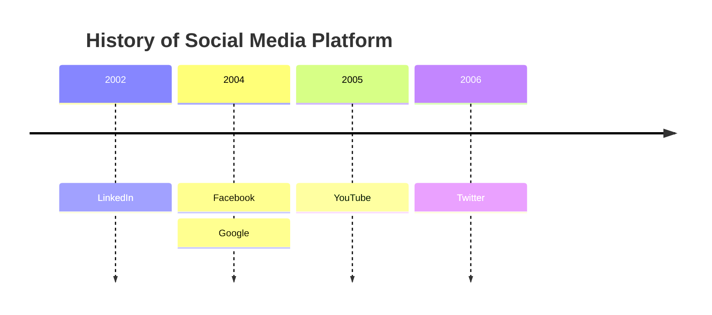
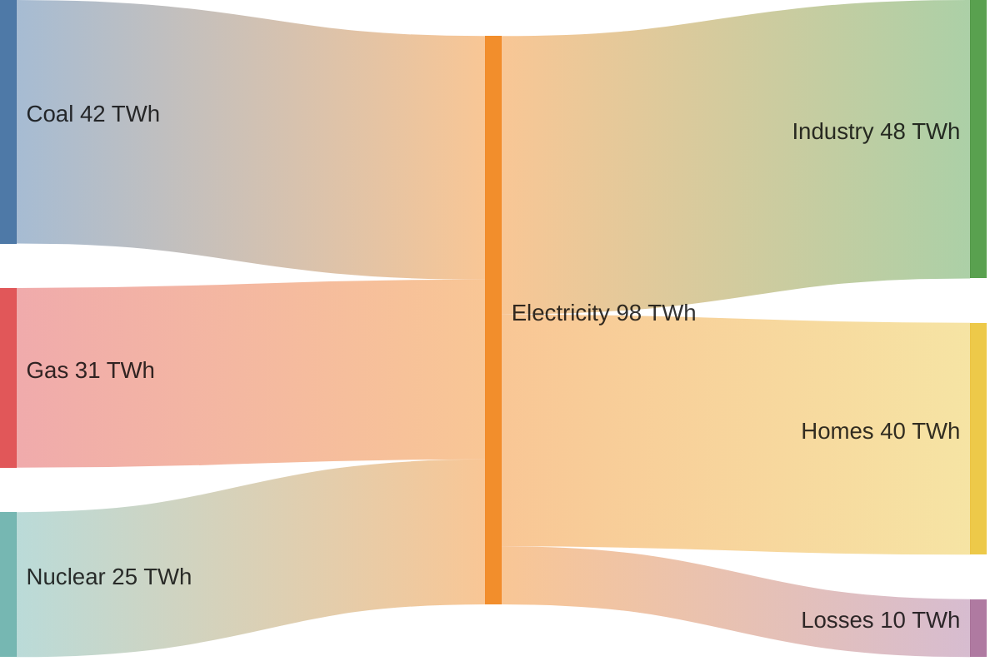

# flowmaid

[](https://github.com/go-routine-id/flowmaid/actions/workflows/ci.yml)
[](https://crates.io/crates/flowmaid)
[](https://docs.rs/flowmaid)
[](LICENSE)

A small Mermaid-like diagram engine written in pure std Rust with zero external dependencies. Takes Mermaid-syntax text and produces SVG — or live, draggable geometry for interactive apps. Twelve diagram types today: flowcharts, ER, UML class, sequence, pie, state, mindmap, user-journey, git graphs, timeline, sankey, and architecture-beta diagrams.

**Website:** https://go-routine-id.github.io/flowmaid/ · **Playground:** https://go-routine-id.github.io/flowmaid-web/ · **Desktop editor:** [flowmaid-desktop](https://github.com/go-routine-id/flowmaid-desktop) · **Terminal:** [flowcli](https://github.com/go-routine-id/flowcli)

## Mermaid parity roadmap

The goal: **mermaid.js functionality, pure-Rust edition.** Progress board with all the details in [issue #10](https://github.com/go-routine-id/flowmaid/issues/10) — contributions welcome, every item has its own issue.

**Targeted mermaid version:** flowchart syntax follows mermaid **12.2.0** (the latest release when this was written); where mermaid 12 changed a default, the difference is noted next to the feature (markdown node labels still wrap at mermaid 11's 200px, not mermaid 12's 120px).

**Diagram types**

- [x] `flowchart` / `graph` — TD/LR/RL/BT, 11 node shapes, 7 link types + labels, chains, fan-out, cycles, self-loops, parallel edges
- [x] `erDiagram` — full crow's foot cardinalities, identifying/non-identifying lines, entity attribute tables
- [x] `classDiagram` — three-compartment boxes, member visibility, all UML relations (inheritance/realization/composition/aggregation/association/dependency), cardinalities + labels *(v0.9.0)*
- [x] `sequenceDiagram` — participants/actors, 8 arrow types, notes, activations, autonumber, loop/opt/alt/par frames *(v0.10.0)*
- [x] `stateDiagram-v2` — `[*]` start/end, composites with nested `[*]`/`direction`, `<<choice>>`/`<<fork>>`/`<<join>>`, transition labels, descriptions *(v0.11.0)*
- [x] `journey` — title/section/task, score-colored smiley faces (1–5), section bands, actor legend + per-task dots *(v0.14.0)*
- [x] `pie` — title, showData, percentage labels + legend *(v0.10.0)*
- [x] `mindmap` — indentation-built tree, radial layout with colored branches, six node shapes (square/rounded/circle/hexagon/bang/cloud) *(v0.13.0)*
- [x] `gitGraph` — LR/TB/BT orientations, commits, branches, checkouts/switches, merges with ids and tags *(v0.22.0)*
- [x] `architecture-beta` — nested groups, services, icons, and port-based edges (`id:L -- R:other`, `-->`, `<-->`, `{group}` qualifiers) *(v0.24.0)*
- [x] `sankey-beta` — CSV `source,target,value` rows, quoted fields, node columns by depth, ribbons sized by value, `config.sankey.*` from frontmatter *(v0.29.0)*
- [x] `timeline` — `title`/`section`, `period : event[: event…]` rows, `:`-continuation lines, `LR`/`TD` direction, `%%`/`#` comments, `<br>` and entity folding *(v0.28.1)*
- [ ] The complete mermaid catalog, tracked on the board: `swimlane-beta` · `gantt` · `quadrantChart` · `requirementDiagram` · `C4` · `zenuml` · `xychart` · `block` · `packet` · `kanban` · `radar` · `eventmodeling` · `treemap` · `venn` · `ishikawa` · `wardley` · `cynefin` · `treeview`

**Flowchart features**

- [x] `subgraph` — nesting, titles, per-block `direction`, edges to/from a subgraph *(v0.5.0, v0.7.0)*
- [x] `<br/>` multi-line labels *(v0.7.0)*
- [x] Markdown strings ``"`**bold** _italic_`"`` in node, edge and subgraph labels — real newlines, automatic word wrap for node labels at mermaid 11's 200px width
- [x] `style` / `classDef` / `class` / `:::` custom colors *(v0.4.0)*
- [x] Semantic color theme (shape-based) + stable accent palette shared by ER / class / sequence / pie
- [x] Interactive scene API — drag nodes, edges re-route live; stable node/edge identity (`SceneNode.id`, `SceneEdge.from`/`to`) and local drag re-routing (`scene`, `route`, `route_partial`, `box_edge_bezier`) *(v0.18.0)*
- [x] Hit-testing / picking — `Scene::{hit_test, node_at, edge_at, cluster_at, hits_in_rect, nearest_node}`, shape-precise, pick-matches-render; completes pick → drag → route for editors *(v0.19.0)*
- [x] Graph → mermaid serializer — `to_mermaid(g)`, the inverse of `parse`: lossless editor round-trip via mermaid entity codes (`#quot;`, `#124;`), valid standard mermaid out; completes pick → drag → route → **persist** *(v0.20.0)*
- [x] `$$math$$` tokenized in labels (Phase A: italic TeX passthrough, correct widths) *(v0.20.0)*
- [x] Compact / serpentine layout — fold a long linear chain into balanced rows to fit a viewport (`fold::scene_compact`, CLI `--compact <px>`) *(v0.18.0)*
- [x] Accessible SVG — `role="img"` + `aria-label` + per-node/edge `<title>`, deterministic byte-identical output *(v0.18.0)*
- [x] `accTitle:` / `accDescr:` / multi-line `accDescr { … }` — the title replaces the SVG's accessible name, the description becomes a `<desc>` with `aria-describedby` (flowchart, state, class, sequence, ER; parsed and not yet drawn for pie, journey, timeline, gitGraph, architecture)
- [x] `flowchart-elk` header — accepted as a `flowchart` alias (flowmaid has one layout engine, so the ELK hint is ignored)
- [x] Injectable font metrics for embedders using a real font (`layout::intrinsic_size_with`, `TEXT_CALIBRATION`) *(v0.18.0)*
- [x] Explicit "not supported yet" errors for every known mermaid header
- [ ] `$$…$$` math in labels, KaTeX-style — Phase A passthrough ✅ v0.20.0; next: MathML subset → native — [#12](https://github.com/go-routine-id/flowmaid/issues/12)
- [x] Fan-out `A --> B & C`, inline `-- text -->` labels, `-.-`/`===` open lines, `~~~` invisible links *(v0.6.0)*
- [x] Edge markers: cross `--x`, circle `--o`, two-way `<-->` / `x--x` / `o--o` on solid, dotted and thick lines
- [x] Edge ids and metadata — `A e1@--> B`, then `e1@{ animate: true }`, `e1@{ animation: slow }`, `e1@{ curve: linear }` (all thirteen mermaid curve names); ids become `id="flowmaid-<hash>-e1"` / `data-id="e1"` (namespaced per SVG like mermaid's), animation is mermaid's CSS dash animation, scoped to the SVG
- [x] More node shapes — cylinder `[( )]`, subroutine `[[ ]]`, hexagon `{{ }}`, parallelograms `[/ /]` `[\ \]`, double circle `((( )))` *(v0.8.0)*; trapezoids `[/ \]` `[\ /]` and asymmetric `>text]` as look-alikes
- [x] Mermaid v11 node metadata `A@{ shape: cyl, label: "DB" }` — every registry shape name accepted (exact geometry for 15 families, nearest look-alike for the rest), mermaid's exact "No such shape" errors, one-line and multi-line YAML forms
- [x] `linkStyle <n>[,<n>…]` / `linkStyle default`, with optional `interpolate <curve>` — per-edge stroke, width, dash, fill and label colour; arrow, cross and circle markers take the stroke colour
- [x] `click` — `href` links with tooltips and `_self`/`_blank`/`_parent`/`_top` targets wrap the node in an SVG `<a>`; urls are sanitised like mermaid's default `strict` level; callbacks parse and are ignored (static SVG runs no script)
- [ ] Frontmatter themes, `$$math$$` — see the board

**Why flowmaid?** Zero dependencies, `wasm32` out of the box (all twelve diagram types fit in a compact wasm bundle — mermaid.js is ~2.5 MB), sub-millisecond renders, line-numbered parse errors, and one geometry source shared by SVG export and interactive canvases. Input is forgiving where it should be: UTF-8 BOMs are stripped, CRLF is fine, and every known-but-unsupported Mermaid header fails with an explicit message instead of a confusing parse error.

## Installation

```bash
cargo add flowmaid
```

Or in `Cargo.toml`:

```toml
[dependencies]
flowmaid = "0.25"
```

## Usage

```bash
cargo build --release

# from a file
./target/release/flowmaid examples/demo.mmd -o demo.svg

# or through a pipe
cat examples/lr.mmd | ./target/release/flowmaid > lr.svg

# fold a long linear chain to fit 300 px along the flow axis
./target/release/flowmaid examples/lr.mmd --compact 300 -o lr-compact.svg

# drop the white background so the SVG sits on any page colour
# (combines with --compact, --advance and --advance-text)
./target/release/flowmaid examples/demo.mmd --transparent -o demo.svg

# during development
cargo run -- examples/demo.mmd -o demo.svg
cargo test
```

It also works as a library (the crate is lib + bin) — one call, any supported diagram type, dispatched on the header:

```rust
let flow = flowmaid::render_svg("flowchart TD\nA[Start] --> B[Done]")?;
let uml  = flowmaid::render_svg("classDiagram\nAnimal <|-- Dog")?;
let fsm  = flowmaid::render_svg("stateDiagram-v2\n[*] --> Idle")?;
```

Rendering options go through `SvgOptions` and `render_svg_advanced` (each diagram module also has a `*_with` writer). `SvgOptions` is `#[non_exhaustive]`: start from `Default` and set the fields you need — that is the supported way to build it, and it keeps compiling as options are added:

```rust
let mut opts = flowmaid::SvgOptions::default();
opts.transparent = true; // no white canvas rect — same as CLI --transparent
opts.responsive = true;  // width="100%" instead of a fixed pixel size
let svg = flowmaid::render_svg_advanced("flowchart TD\nA --> B", &opts)?;
```

Transparent output keeps the default dark text and edge colours, so it reads best on light-to-mid backgrounds; dark-page theming is tracked in [#57](https://github.com/go-routine-id/flowmaid/issues/57).

## Supported syntax

The header sets the flow direction: `flowchart TD` (top-down, alias `TB`), `LR` (left-right), `RL`, or `BT`. The keywords `graph` and `flowchart-elk` are also accepted; `flowchart-elk` asks mermaid for its ELK layout engine, and flowmaid, which has a single layout, treats it as plain `flowchart`. Lines starting with `%%` are comments, and `;` separates multiple statements on one line.

Accessibility statements follow mermaid: `accTitle: text` replaces the SVG's accessible name (`<title>` and `aria-label`, default "Flowchart diagram"), and `accDescr: text` or a multi-line `accDescr { … }` block adds a `<desc>` that the root `aria-describedby` points at (its id is a content hash, so inlined SVGs never collide). As in mermaid the value runs to the end of the line (`;` and `%%` included), the keywords are case-sensitive, the last statement wins, and a block's continuation indentation and blank lines fold away. They work in state, class, sequence and ER diagrams too. An unclosed `accDescr {` is a line-numbered error (mermaid swallows the rest of the file). Inside a multi-line markdown string or `@{ … }` block the keywords are plain label / YAML text, as in mermaid; after one closes, a statement can follow a `;` on the same line.

Node shapes: `A[text]` rectangle, `A(text)` rounded, `A([text])` stadium, `A{text}` diamond, `A((text))` circle, `A(((text)))` double circle, `A[(text)]` cylinder (database), `A[[text]]` subroutine, `A{{text}}` hexagon, `A[/text/]` and `A[\text\]` parallelograms; the trapezoids `A[/text\]` and `A[\text/]` and the asymmetric `A>text]` parse too and draw as the same nearest look-alikes as their `@{ shape: … }` names below. Mermaid v11 node metadata works too: `A@{ shape: cyl, label: "DB" }`, glued after the id (and after any bracket shape or `:::class`, which it overrides), on one line or spread over several (YAML block form, `label: |` / `label: >` block scalars read like js-yaml — a folded line indented past the rest keeps its own line, and a line indented less than the first is an error — a quoted value broken across lines becomes a line break). Every name in mermaid's shape registry is accepted: `rect`, `rounded`, `stadium`, `fr-rect`, `cyl`, `circle`, `dbl-circ`, `diam`, `hex`, `lean-r`, `lean-l`, `sm-circ`, `fr-circ`, `fork`, `f-circ` and their aliases draw their exact flowmaid shape; names flowmaid has no geometry for yet (`doc`, `trap-b`, `cloud`, `delay`, `tri`, …) draw the nearest look-alike, and `text` / braces / `bolt` draw without a box. An unknown name, or one with uppercase or `_`, fails with mermaid's own "No such shape" message. As in mermaid 12, a metadata `label` is markdown — `A@{ label: "**b** _i_" }` is bold and italic and wraps like a ``"`…`"`` label — unless `labelType: string` or `labelType: text` keeps it plain. `icon`, `img`, `form`, `pos`, `w`, `h` and `constraint` are accepted but not drawn (an icon/image node keeps its id as its label). The block ends at its first `}`, as in mermaid's lexer, so a nested `{…}` value is an error — quote it. Labels may be quoted to protect special characters (`A["odd [text]"]`) and use `<br/>` for line breaks. Markdown strings work as in mermaid: a label written as ``"`…`"`` (a quote directly followed by a backtick) takes `**bold**` / `__bold__`, `*italic*` / `_italic_` (CommonMark's flanking rules, so `snake_case` and `2 * 3` stay plain) and backslash escapes, and may span several lines; a newline is a line break (its indentation dropped), blank lines count once, and `<br/>` still breaks. Other markdown (headings, lists, links, code, strikethrough) shows as written, which is what mermaid's default HTML labels do. Node labels wrap at mermaid 11's 200px markdown width (175px at flowmaid's 14px text; an over-long word is not split); edge labels and subgraph titles are styled but stay on one line. A bare ``subgraph "`**Two**`"`` takes the markdown text as its id, like mermaid. A raw backtick or `"` inside the string is a line-numbered error (write `#96;` / `#quot;`), and ``"``"`` is an empty label (mermaid rejects it). Entity codes in the text never act as markdown (`#42;` is a literal `*`). Labels are lowered to flowmaid's `<b>` / `<i>` / newline markup at parse time, so the wrap uses the built-in width estimate even when an embedder supplies real font metrics. Mermaid entity codes are decoded in every label position (`#quot;` → `"`, decimal `#65;` → `A`) — since v0.20.0, matching mermaid.js; control characters are refused.

Edges: `-->` arrow, `---` open line, `-.->` dotted, `-.-` dotted open, `==>` thick, `===` thick open, and `~~~` invisible links that shape the layout without being drawn. Labels come in both mermaid spellings — `-->|text|` and inline `-- text -->` (`-. text .-`, `== text ==>`). Cross and circle ends (`--x`, `-.-x`, `==x`, `--o`, `-.-o`, `==o`, also `-- text --x`) and two-way links (`<-->`, `<-.->`, `<==>`, `x--x`, `o--o`, also `<-- text -->`) draw the matching glyph at each end. As in mermaid, a marker letter glued to the operator is the marker: `A---oB` is a circle edge to `B` — write `A --- oB` to target a node named `oB`. Fan-out lists work on either side: `A --> B & C`, `A & B --> C`. An edge can carry an id written before its operator — `A e1@--> B`, `A e1@-- text --> B`, `A e1@x--x B` — which the SVG writes as `id="flowmaid-<hash>-e1" data-id="e1"` — mermaid's `<diagram-id>-<edge-id>`, with a content-hashed, deterministic diagram id that the root `<svg>` carries (only when the diagram has edge ids or animation), so several SVGs inlined on one page never share an edge id. A later `e1@{ … }` statement sets its metadata, mermaid-style: `animate: true` (or `animation: fast` / `slow`) adds mermaid's `edge-animation-*` class plus its dash-animation CSS, scoped to that SVG (`#flowmaid-<hash> .edge-animation-fast`, keyframes `flowmaid-<hash>-dash`) so it never restyles the host page, and `curve:` picks the path shape (`basis` default, `linear`, `rounded`, `step`, `stepBefore`, `stepAfter`, `bumpX`, `bumpY`, and `natural` / `monotoneX` / `monotoneY` / `cardinal` / `catmullRom`, which flowmaid draws as one Catmull-Rom spline; an unknown name means `basis`). The block may span lines (YAML block form). As in mermaid, with fan-out only the last-source → first-target pair takes the id, a repeated id is silently dropped, and metadata written before its edge exists is a node. Chains like `A --> B & C --> D` are supported, as are cycles (`E --> B` looping back up) and self-loops (`A --> A`).

Subgraphs use mermaid's block syntax — `subgraph id [Title]` … `end` — with arbitrary nesting and an optional `direction LR` line per block (inherited from the parent otherwise). A node mentioned inside a block is claimed by it, mermaid-style, even if it first appeared elsewhere. Edges may freely cross cluster borders, and an edge may target a subgraph *itself* (`CF --> VPC`) — it attaches to the cluster box; forward references (edge before the block) work via a pre-scan. See `examples/subgraph.mmd`.

Edges are styled with mermaid's `linkStyle`: `linkStyle 3 stroke:#ff3,stroke-width:4px,color:red` styles the fourth link, `linkStyle 1,2,7 color:blue` several (no spaces in the list), and `linkStyle default …` every link, including ones defined later. Indices count every link in source order, as mermaid does: each pair of a fan-out (`A & B --> C & D` is A-C, A-D, B-C, B-D), invisible `~~~` links, and links to a subgraph; an index past the links defined so far is mermaid's line-numbered "out of bounds" error. Properties: `stroke` (the arrow, cross and circle markers take the same colour), `stroke-width` (0 to 1000px; the arrowhead keeps its normal size, as in mermaid), `stroke-dasharray` (`5 5`; `0` makes a dotted edge solid), `fill` and `color` (edge label text); unknown properties are ignored, and so is the bare `5` mermaid splits off `stroke-dasharray:5,5`. A later `linkStyle` for the same index replaces the earlier one; the default and an index style merge per property, the index winning. `linkStyle <n> interpolate <curve>` (with or without styles) sets the curve, using the same names as `curve:` above; an `e1@{ curve: … }` on the same edge wins. A `~~~` link stays hidden unless its style sets a positive `stroke-width`, as in mermaid, and never gets markers. Two deliberate differences from mermaid: when both the default and an index style set `stroke`, the markers follow the colour the line is drawn in (mermaid takes the default's), and a circle marker is filled as well as outlined in the edge colour (mermaid colours only its outline).

Links use mermaid's `click` statement: `click A "https://example.com"`, `click A href "https://example.com" "Tooltip" _blank` (url, then optional tooltip, then optional `_self` / `_blank` / `_parent` / `_top`, in that order), and `click A,B "url"` for several nodes. The SVG wraps the node in `<a href=… xlink:href=…>` (with `rel="noopener noreferrer"` on `_blank`; no `target` means the same tab, as in mermaid), and a tooltip becomes the node's `<title>`. Urls are checked like mermaid's default `strict` security level (a port of `@braintree/sanitize-url`): after decoding percent escapes, HTML and mermaid entities and dropping control and invisible characters, a `javascript:`, `data:` or `vbscript:` url is not linked at all (mermaid would write `about:blank`); relative, scheme-less, `mailto:`, `https:` and other urls stay exactly as written. Callbacks (`click A callback`, `click A call fn(args) "tooltip"`) are accepted for compatibility and ignored, since a static SVG runs no script, but their tooltip still applies. As in mermaid, a link only lands on a node that already exists: an unknown id, a subgraph or edge id, or a node declared further down is ignored without creating a node, while a tooltip reaches a node declared later. Keywords are case-sensitive (`Click A` is a node), and flowmaid is lenient about extra spaces (`click A  href  "u"`), which mermaid rejects. Scene consumers get the link and tooltip on `SceneNode::link`.

Custom colors use mermaid's styling syntax: `style A fill:#f9f,stroke:#333,stroke-width:4px,color:#fff`, reusable classes via `classDef hot fill:#ffe3e3,stroke:#e03131` + `class A,B hot` or the inline shorthand `A:::hot`. Supported properties: `fill`, `stroke`, `stroke-width` (0 to 1000px), `color` (label text); unknown properties are ignored, and so is a bare item after a property (mermaid splits values on every comma, so `stroke-dasharray: 9,5` leaves a stray `5`); a statement starting with a bare item is an error. Unstyled nodes fall back to a semantic theme — shape determines color (stadium green, diamond amber, circle violet, ...; see the `style` module) — and ER entities cycle through a stable accent palette.

Complete examples live in `examples/` — `demo.mmd` and `lr.mmd` for the basics, `advanced.mmd` for everything at once (nested subgraphs, all shapes and link types, `<br/>`, custom colors), plus one showcase per diagram type (`er`, `class`, `sequence`, `pie`, `state`).

## Entity-Relationship diagrams

`erDiagram` input renders entities as attribute tables connected with crow's foot notation:

```
erDiagram
    users ||--o{ posts : "writes"
    users {
        uuid id PK "default gen_random_uuid()"
        varchar(255) email UK "not null"
    }
```

Supported subset: relationships with all crow's foot cardinalities (`||` exactly one, `|o`/`o|` zero or one, `}o`/`o{` zero or many, `}|`/`|{` one or many), identifying (`--`, solid) and non-identifying (`..`, dashed) lines, optional relationship labels, and entity blocks with `type name [PK|FK|UK] ["comment"]` rows. Types with parentheses (`varchar(255)`) and comments containing commas, parentheses, or single quotes are handled. Entities mentioned only in relationships render as title-only tables. Attribute comments are parsed into the model but not drawn. See `examples/er.mmd`.

## Class diagrams

`classDiagram` input renders UML classes as three-compartment boxes (name / fields / methods) connected with UML relationship glyphs:

```
classDiagram
    class Animal {
        +String name
        -int age
        +move() void
    }
    Animal <|-- Dog
    Animal "1" o-- "*" Toy : owns
    Dog "1" --> "*" Toy : plays with
    Cat ..> Toy : ignores
```

Supported subset: class blocks with `+ - # ~` member visibility (a member with `()` becomes a method, otherwise a field); inline members via `Name : +member`; multiple classes in one line (`class Duck, Fish`); and all UML relations — inheritance `<|--`, realization `..|>`, composition `*--`, aggregation `o--`, association `-->`, dependency `..>`, and plain link `--`/`..`, in either direction. Each relation takes optional `"cardinality"` strings on each side (a colon or operator inside the quotes is protected) and a `: label`; the diagram is normalised so the end glyph (hollow triangle, filled/hollow diamond, or open arrow) always sits at the target end. Dashed lines are used for realization and dependency. Trailing `%%` comments and `direction` / `note` lines are accepted and ignored. Not yet rendered: generics (`List~T~`), `<<stereotype>>` badges, and `namespace` blocks. See `examples/class.mmd`.

## Sequence diagrams

`sequenceDiagram` input renders participant boxes across the top, dashed lifelines below, and one row per statement top-down:

```
sequenceDiagram
    autonumber
    actor U as User
    participant API
    U->>+API: GET /profile
    API-->>-U: 200 OK
    Note over U,API: cached for 60s
    loop every minute
        API->>API: refresh token
    end
```

Supported subset: `participant` / `actor` declarations with `as` aliases (actors draw as outlined boxes; implicit participants are created on first mention, in order of appearance); all eight message arrows — `->>` solid + filled head, `-->>` dashed + filled head, `->` / `-->` plain lines without a head, `-x` / `--x` cross ends, `-)` / `--)` async open arrows — including self-messages (`A->>A:`, drawn as a loop beside the lifeline); `autonumber` (bold `1.` prefixes on messages); notes in all four forms (`Note over A,B:`, `Note over A:`, `Note left of A:`, `Note right of A:` — keywords case-insensitive); activation bars via `activate` / `deactivate` or the `+`/`-` arrow shorthand (`A->>+B:` activates B, `B-->>-A:` deactivates B; unbalanced deactivation is a line-numbered error); and `loop` / `opt` / `alt`+`else` / `par`+`and` frames drawn as labeled boxes with dashed dividers. Trailing `%%` comments are stripped. Limitations: message and note text is single-line (`<br/>` collapses to a space), frames span the full diagram width rather than only the involved participants, and `box`, `rect`, `critical`, `break`, `create`/`destroy`, and `autonumber` arguments produce an explicit "not supported yet" error. See `examples/sequence.mmd`.

## Pie charts

`pie` input renders proportional slices (clockwise from 12 o'clock, in source order) with percentage labels and a color legend:

```
pie showData
    title Key elements in Product X
    "Calcium" : 42.96
    "Potassium" : 50.05
    "Magnesium" : 10.01
    "Iron" : 6
```

Supported subset: all header forms (`pie`, `pie showData`, `pie title …`, `pie showData title …`), a standalone `title …` line, and `"Quoted Label" : value` data rows with non-negative numbers. `showData` appends the raw value to each legend entry (`Calcium [42.96]`). Slices under 4% skip their percentage label but keep their legend row, zero-value slices are legend-only, a single 100% slice renders as a full circle, and an all-zero total draws an empty outline instead of NaN geometry. A duplicate label keeps one slice — the last value wins. Colors come from the same stable accent palette as ER/class diagrams (wrapping after 8 slices). `accTitle` / `accDescr` lines are accepted (the value stops at `%%`, as in mermaid's langium grammar) but not yet written into the SVG. Not supported: config/theme directives (`%%{init: …}%%`). See `examples/pie.mmd`.

## State diagrams

`stateDiagram-v2` (and the v1 `stateDiagram` header) rides the flowchart pipeline: states are rounded nodes, transitions are labelled edges, and composite states are the same nested clusters subgraphs use — so dragging, custom positions, and SVG export all work unchanged:

```
stateDiagram-v2
    [*] --> Idle
    Idle : waiting for input
    Idle --> Validating : submit
    state Validating {
        direction LR
        [*] --> Syntax
        Syntax --> Semantics : ok
        Semantics --> [*]
    }
    state decide <<choice>>
    Validating --> decide
    decide --> Done : valid
    Done --> [*]
```

Supported subset: `[*]` start/end pseudostates (scoped — a composite gets its own), transitions `A --> B : label`, bare-id state declarations, `state "Long title" as id`, description lines `id : text` (the first replaces the id as the label, later ones stack), composite `state X { ... }` blocks with nesting, per-composite `direction`, transitions to/from a composite box itself (forward references included), and `<<choice>>` (diamond) / `<<fork>>` / `<<join>>` (bars). `note ...` lines and `note ... end note` blocks are accepted and skipped. Not yet: concurrency regions (`--`), rendered notes, entry/exit actions. See `examples/state.mmd`.

## Timeline diagrams

A `timeline` draws periods as columns on a horizontal axis, with events stacked beneath each period and sections as colored header bands:



Supported subset, mirroring mermaid's timeline contract: optional `title`; `section <name>` groups (periods before the first `section` form a leading unnamed band drawn without a header); `period : event[: event…]` rows with several events inline; a bare `: event` line that continues the previous period's events; `LR` (default) and `TD` direction; `%%` and `#` comments; and `<br>` folding plus `#quot;`/`#NN;` entity decoding. A `:` in event text is literal unless followed by whitespace — so `https://example.com` and `::` survive intact, and a `:` in the *period* position (`2004 : e1 : e2`) separates events. Colors cycle through the stable accent palette per section.

## Sankey diagrams

A `sankey-beta` diagram draws weighted flows as ribbons whose thickness is proportional to their value. The body is CSV — one `source,target,value` row per flow — and nodes are created on first mention, keyed by their label:



Supported subset: rows of exactly three fields; double-quoted fields, where `""` is one literal quote, so a label may contain commas; `%%` comments and blank lines; repeated labels reusing one node; and `sankey` accepted as a spelling variant of `sankey-beta`.

Layout follows d3-sankey, which is what mermaid wraps. A node sits in the column of its **longest** path from a source, so every ribbon points rightwards, and its thickness is the larger of its inflow and outflow — a node that merely splits its input never shrinks. Within a column, nodes are ordered by the barycentre of their neighbours to reduce crossings (minimising crossings exactly is NP-hard, so this is the standard heuristic) with ties broken by declaration order, which keeps the SVG a stable function of the input.

Configuration is read from mermaid's YAML frontmatter under `config.sankey`, and every default matches mermaid's `config.schema.yaml`:

| Key | Default | Notes |
|---|---|---|
| `width` / `height` | `600` / `400` | Canvas size |
| `linkColor` | `gradient` | Also `source`, `target`, or any CSS colour |
| `nodeAlignment` | `justify` | Also `left`, `right`, `center` |
| `showValues` | `true` | Draws the node total beside its label |
| `prefix` / `suffix` | `''` | Wrapped around a shown value |
| `nodeWidth` | `10` | Node rectangle width |
| `nodePadding` | `12` | Vertical gap between nodes in a column |

An unknown key is skipped and a value that does not parse keeps its default, so config for other diagram types in a shared file never breaks the render. See `examples/sankey.mmd`.

Other Mermaid diagram types (`gantt`, `quadrantChart`, ...) are detected and produce an explicit "not supported yet" error instead of a confusing parse failure.

## Advance swimlane diagrams (JSON input)

Beyond mermaid-syntax text there is an engine-native swimlane renderer in the `advance` module — vertical lane columns, top-down nodes, orthogonal edge routing, all sharing the flowchart shapes and edge kinds. The input is plain JSON (no mermaid header):

```json
{
    "lanes": [{ "id": "dev", "title": "Development" },
              { "id": "qa",  "title": "QA" }],
    "nodes": [{ "id": "a", "label": "Design", "lane": "dev" },
              { "id": "b", "label": "Test", "lane": "qa", "shape": "diamond" }],
    "edges": [{ "from": "a", "to": "b", "label": "hand off" }]
}
```

`advance::render_advance_svg(&str)` goes straight from JSON to SVG, and `advance::layout_advance` returns the positioned geometry (`AdvanceScene`) for GUI painters. Drag-mode re-renders come from `advance::render_advance_routed` (node centre positions) and `advance::render_advance_routed_with_lanes` (plus caller-controlled lane widths, margin, and inter-lane gap); content dragged outside the canvas is translated back into view, and the canvas grows to hold any route that leaves the lanes. Because this diagram kind has no mermaid header, it is outside the parity roadmap above — the counts elsewhere in this document refer to mermaid-syntax types only.

### Advance text DSL

The same swimlane engine also takes a concise text notation (`advance::render_advance_text_svg`), with nested lanes, per-node/per-edge styling, ported edges, and `<br/>` line breaks:

```mmd
classDef primary fill:#e8f0fe,stroke:#4285f4,stroke-width:3
config margin 24

lane backend "Backend" {
  a[Auth]::primary
  b[API Gateway]
  a --> b
}
lane web "Web" {
  c{Check}
  c --> b:top        # ported edge — enter b through its top
}
style a-->b color:#188038,dash:4 2
style c fill:#fff8e1
```

- **Nested lanes** — a `lane id "Title" { ... }` block opens a child scope; a standalone `}` closes it. Nodes attach to the innermost open lane.
- **`config`** — `config margin 24`, `config lane_gap 36`, `config node_gap_y`, `config lane_pad_x/y`, `config lane_title_h`, `config order declaration|topology`. Unknown keys are ignored.
- **Styling** — Mermaid-style directives, resolved after the whole file parses:
  - `classDef <name> k:v,k:v` defines a reusable class; `class a,b <name>` (or the `a::name` shorthand) applies it.
  - `style <id> k:v,k:v` styles a node by id, or an edge by literal `from-->to` (ports allowed: `style a:right-->b:top ...`).
  - Node keys: `fill`, `stroke`, `stroke-width`, `color` (label text). Edge keys: `color`, `stroke-width`, `dash` (space-separated values, e.g. `dash:4 2`), `label-fill`.
- **Ports** — an endpoint can pin its anchor side: `a:right --> b:top` (`left`/`right`/`top`/`bottom`/`auto`; `auto`/missing = automatic routing). A ported edge's first/last segments leave the sides perpendicularly.
- **`<br/>`** — normalised to a line break in node labels, edge labels (`-->|a<br/>b|`), and lane titles.
- **Terminals — sub-elements and named anchors.** A node can open a block holding *sub-elements* (compartments) and *anchors* (named points on a boundary); an edge end then references any of them by id:

  ```mmd
  cpu[CPU] {
    anchor out bottom 0.5
    core0[Core 0]
    core1[Core 1] { anchor irq right }
    layout column
  }
  cpu.core1@irq --> mem.bank0
  cpu@out       --> bus:top
  cpu.core0     --> mem.bank1
  ```

  `anchor <id> <side> [offset 0..=1]` declares a point (offset `0.5` when omitted); `layout column` is the default, `row` lays sub-elements side by side. The three edges read: anchor on a sub-element → sub-element; named anchor on the node → a side; sub-element → sub-element with the sides chosen for you.

  `.` descends into sub-elements, `@` names an anchor, `:` picks a side — composably, to any depth. Ids may therefore not contain `.` or `@`. Sub-elements are laid out without coordinates (stacked, or `layout row`) and the node grows to fit; a sub-element side can be used only if it reaches the node boundary — in a column `left`/`right` always and `bottom` for the last child, in a row `bottom` always and `left`/`right` for the first/last; `top` never, because the node's label band sits there — an interior side is a parse error. Sub-elements need a `rect` or `rounded` node — compartments are rectangles and would poke through any other outline. A block may also be written on one line (`core1[Core 1] { anchor irq right }`), blocks nest, and a lane may be written the same way (`lane l "L" { a[A]; b[B] }`). An edge between two sub-elements of one node leaves through an exposed side and comes back in through another, so it always travels outside the node. See `examples/advance_terminals.mmd`.
- The CLI exposes the same entry point as `--advance-text <file.mmd>`.

The JSON form supports the same features additively — nodes/edges carry `style` (`fill`/`stroke`/`stroke-width`/`color`; edges add `dash`/`label-fill`), edges accept `from_side`/`to_side` (`"left"|"right"|"top"|"bottom"|"auto"`), nodes take `anchors` (`{id, side, offset}`), `elements` (nested, each with its own `anchors`/`elements`/`layout`) and `layout`, and `from`/`to` accept the full reference grammar (`"cpu.core1@irq"`). The scene exposes each node's placed `elements` and resolved `anchors`, each edge's `from_point`/`to_point`, and `crossings` — how many pairs of edges cross in the drawing, which the router minimises and a host can display. `AdvanceScene` also offers drag-and-drop picking: `hit_test`, `anchor_at`, `element_at`, `node_at`, `edge_at`, `lane_at`, and `nearest_node` (see `examples/advance_swimlane.mmd`, `examples/advance_terminals.mmd` and `examples/advance_text.rs`).

## Architecture

A three-stage pipeline, one module per stage:

1. `parser.rs` — hand-written character-cursor parser. Each line is parsed into a chain of nodes and edges, with line-numbered error messages.
2. `layout.rs` — a Sugiyama pipeline following [dagre](https://github.com/dagrejs/dagre) (the algorithm mermaid.js uses): (a) DFS marks *back-edges* so cycles can't break the layering, (b) *longest-path layering* assigns nodes to layers, (c) long edges are split into per-layer *dummy chains* so they reserve straight routing channels, (d) *ordering* reduces crossings with weighted-median sweeps plus a local adjacent-swap transpose, keeping the layering with the fewest crossings across eight rounds, (e) *Brandes-Köpf* coordinate assignment runs four vertical alignments (up/down × left/right) and blends them by the per-node median, so long edges come out as straight vertical runs and fan-in/out nodes centre over their neighbours. Subgraphs are laid out in the *same* global pass rather than collapsed: *border-node walls* keep each cluster's members in a compact band (so cross-cluster edges route through the gaps, not the boxes), and a labelled long edge sizes the middle dummy of its chain to its label so converging labels claim their own slots instead of piling up. Everything is computed in abstract coordinates (breadth × layer), so all four diagram directions are handled by a single transform at the end.
3. `render.rs` — maps abstract coordinates to final x,y according to the direction, then draws bezier curves with arrowheads (SVG markers), clips lines exactly at shape borders (rectangles, circles, and diamonds each have their own intersection formula), and places labels at curve midpoints.

`model.rs` holds the shared data structures (`Graph`, `Node`, `Edge`, shape and direction enums).

For interactive apps there is the `scene` module: `scene()` produces final ready-to-draw geometry (node positions, edge bezier curves), `route()` re-routes edges for custom node positions such as user drags, and `to_svg()` exports any arrangement. `render()` is now just a wrapper over the same pipeline. See `examples/drag_sim.rs` and the egui demo app.

The `er` module maps an `ErDiagram` onto the same machinery and mirrors the `scene` API: `er::scene()` for automatic layout, `er::route()` to follow dragged entity positions, `er::to_svg()` to export any arrangement. Each entity becomes one node of a synthetic left-to-right graph (sized from its attribute table via `scene::scene_sized`), each relationship one edge; only the writer differs — tables instead of shapes, crow's foot glyphs (exposed as plain geometry via `er::glyph`) instead of arrowheads.

The `class` module follows the same pattern for `classDiagram`: `class::scene()`, `class::route()`, `class::to_svg()`. Each class becomes one node of a synthetic top-down graph (sized from its member list), each relationship one edge; the writer draws three-compartment boxes and UML end glyphs (exposed as plain geometry via `class::head`) at the target end.

The `seq` module is different: sequence diagrams are not graphs, so it skips the Sugiyama pipeline entirely. `seq::scene()` computes a linear layout — columns from declaration order (gaps widened until every message label and note fits), one row per statement top-down — and returns every box, lifeline, message polyline, note, activation bar, and frame in final coordinates; `seq::to_svg()` serialises any scene, and `seq::head` exposes arrowheads as plain geometry for GUI painters.

The `pie` module is pure geometry — no graph at all. `pie::scene()` returns the circle, per-slice angles/fractions, percentage-label anchors, and legend rows; `pie::to_svg()` serialises them (a ~100% slice becomes a real `<circle>`, since a single SVG arc cannot sweep 360°).

State diagrams need no module of their own: the parser maps them straight onto `Graph` (states are rounded nodes, `[*]` pseudostates are dedicated shapes, composites are subgraph clusters), so they inherit the whole flowchart pipeline — including `route()` and dragging — for free.

## Performance

A built-in benchmark lives in `examples/bench.rs` (pure std, deterministic synthetic graphs) — run it with `cargo run --release --example bench`. Measurements on Linux x86_64, rustc 1.75, release build, best of 3 runs:

| nodes | edges  | parse   | layout  | render* | SVG      |
|------:|-------:|--------:|--------:|--------:|---------:|
| 49    | 100    | 0.04 ms | 0.03 ms | 0.29 ms | 23 KB    |
| 200   | 400    | 0.16 ms | 0.08 ms | 1.13 ms | 97 KB    |
| 1,000 | 2,010  | 0.84 ms | 0.50 ms | 6.16 ms | 505 KB   |
| 2,500 | 5,050  | 1.97 ms | 1.30 ms | 16.35 ms| 1,278 KB |
| 5,000 | 10,150 | 4.16 ms | 2.75 ms | 34.92 ms| 2,618 KB |

\* the render column includes running layout internally.

End-to-end through the CLI for the 5,000-node case — including reading 10,151 input lines and writing a 2.7 MB SVG — takes about 60 ms with ~9 MB peak RAM. The quadratic-trap case (2 layers × 2,500 nodes side by side) finishes in 21 ms, so practical scaling is linear. For realtime use this means: re-rendering from scratch on every keystroke is fine for reasonable diagrams (~0.3 ms), and the 60 fps budget (16 ms) is only reached around 2,500 nodes. The bottleneck is SVG string building, not the algorithms. Numbers depend on hardware — re-measure on your machine with the command above, and always use `--release` (debug builds are ~10× slower).

## Interactivity & desktop apps

Beyond static SVG, the engine exposes an interactive API for GUI apps through the `scene` module: `scene(&graph)` returns a `Scene` — the position, size, and shape of every node plus the bezier curve of every edge in final coordinates — ready to draw with any framework's painter. When a node is dragged, call `route(&graph, &positions)` to re-route edges for custom positions *without* re-running layout — so nodes never jump back. `to_svg(&scene)` exports any state, including after drags. Hit-testing is done by the app from the `Scene` geometry (per-node position + size + shape are all there). Nodes with a mermaid `click` carry it on `SceneNode::link` (url, target, tooltip), so a host can open the link or show the tooltip itself. The same `scene`/`route`/`to_svg` triple exists for ER (`er::`) and class (`class::`) diagrams, and state diagrams ride the flowchart API directly; sequence diagrams and pie charts are static (their `scene()` has no `route()` — nothing sensible to drag).

Consumers built on this API (separate repos; the engine itself stays dependency-free): [flowmaid-desktop](https://github.com/go-routine-id/flowmaid-desktop), an eframe/egui editor with document tabs, a folder explorer, drag & drop canvas with zoom & pan, and SVG export; [flowmaid-web](https://github.com/go-routine-id/flowmaid-web), the wasm playground with the same drag model in the browser; and [**flowcli**](https://github.com/go-routine-id/flowcli), a terminal renderer (ratatui) that draws the `Scene` as Unicode box- and line-drawing — **no SVG at all**, the clearest proof the scene API is genuinely renderer-agnostic. For other frameworks: Tauri/Dioxus can inject the SVG string into a webview; iced has an svg widget; Slint and GTK4 render SVG natively; or draw the `Scene` directly with each framework's painter like the desktop and terminal apps do.

## Limitations & ideas

Already handled: the canvas is computed from the bounding box of all curve control points so self-loops and back-edges are never clipped; parallel edges (same node pair) separate automatically; long edges that align with a column of nodes bow sideways as a mitigation.

Still open: text width is estimated (~character-class table) since there are no real font metrics, so very long labels or CJK can be off; the long-edge mitigation is only a heuristic — the real solution is *virtual nodes* per crossed layer; edge labels can collide with nodes on dense diagrams; escaped quotes (`\"`) inside labels aren't supported; graphs with subgraphs route all edges with the position-aware free router (no layered back-edge arcs inside clusters). The full mermaid.js parity roadmap lives in [issue #10](https://github.com/go-routine-id/flowmaid/issues/10).

## License

GPL-3.0-or-later — free for everyone to use; distributed derivatives must remain open source under the same license. Full text in the `LICENSE` file.
