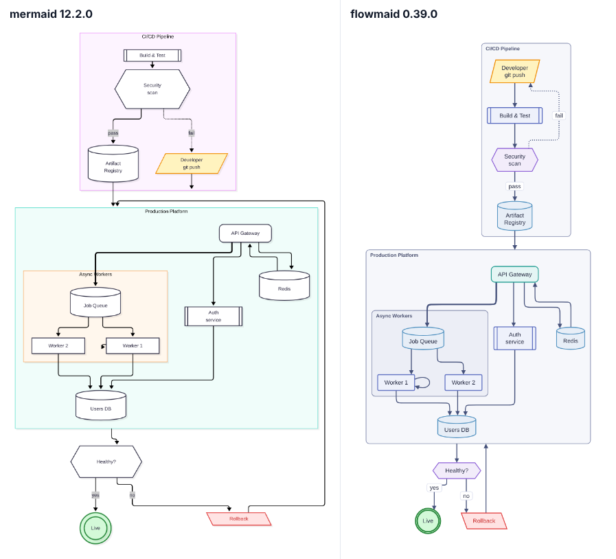
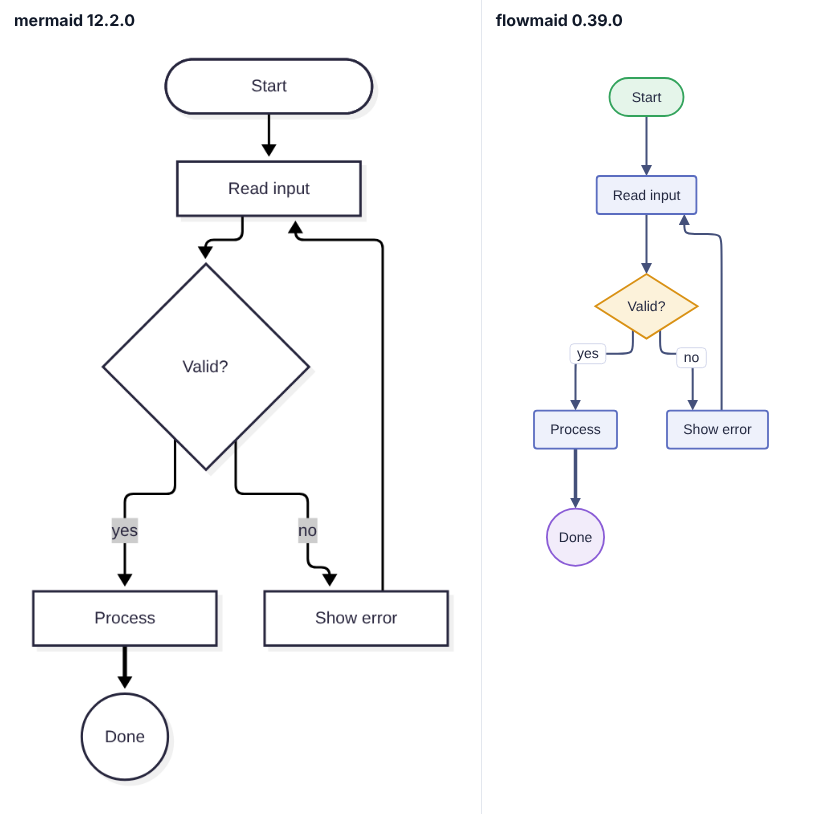
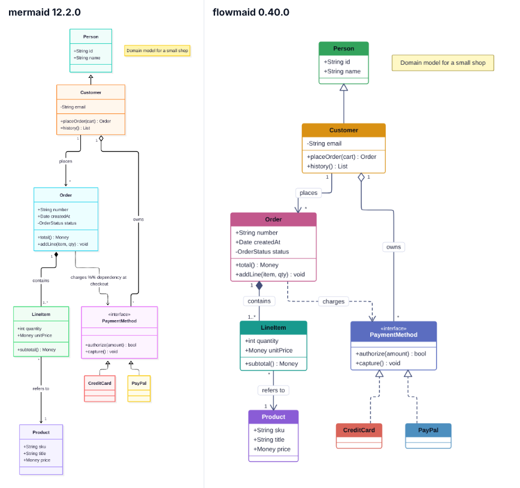
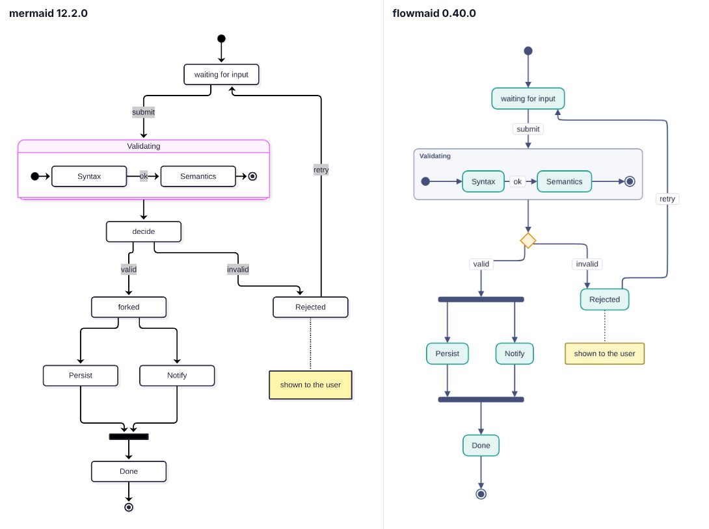
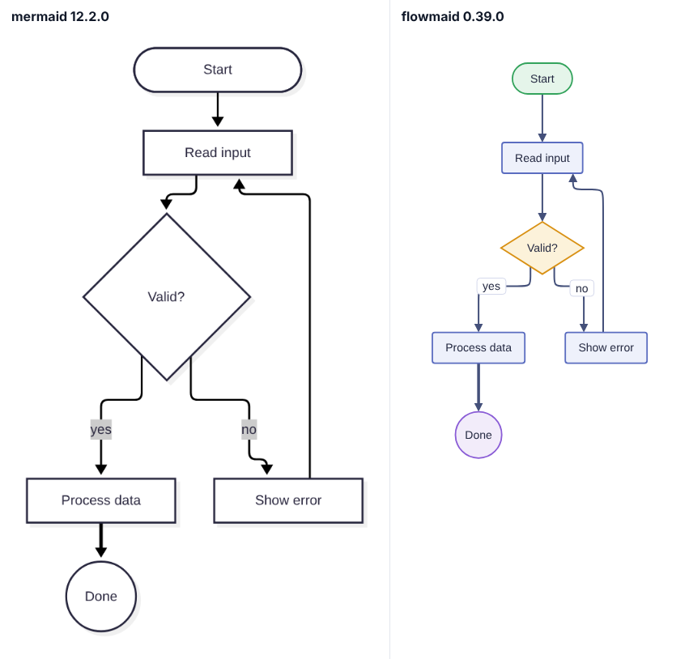
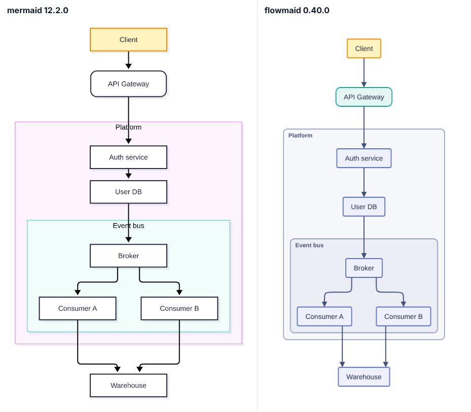
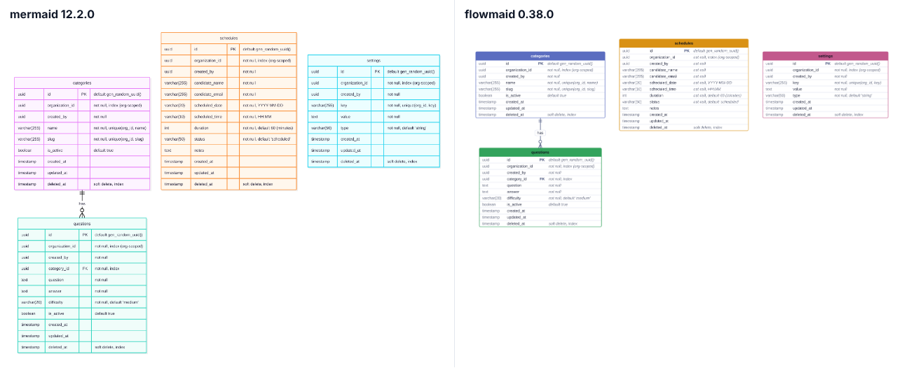
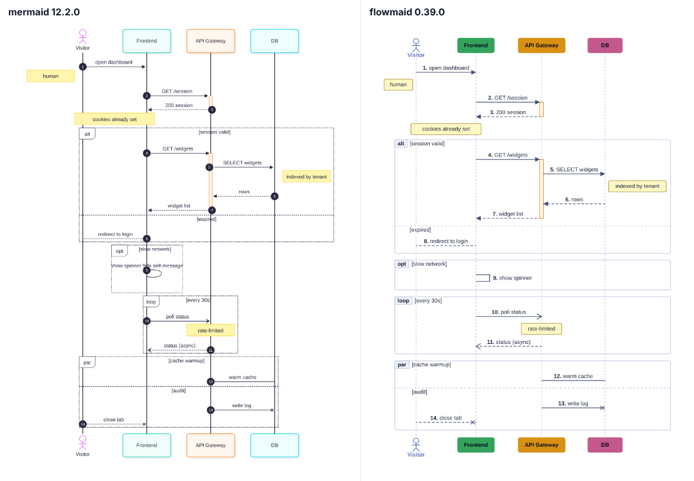

# flowmaid

[](https://github.com/go-routine-id/flowmaid/actions/workflows/ci.yml)
[](https://crates.io/crates/flowmaid)
[](https://docs.rs/flowmaid)
[](LICENSE)

A small Mermaid-like diagram engine written in pure std Rust with zero external dependencies. It takes Mermaid-syntax text and produces SVG — or live, draggable geometry for interactive apps. Twelve diagram types today: flowcharts, state, UML class, entity-relationship, sequence, pie, user-journey, git graphs, mindmap, timeline, sankey, and architecture-beta diagrams.

**Website:** https://go-routine-id.github.io/flowmaid/ · **Playground:** https://go-routine-id.github.io/flowmaid-web/ · **Desktop editor:** [flowmaid-desktop](https://github.com/go-routine-id/flowmaid-desktop) · **Terminal:** [flowcli](https://github.com/go-routine-id/flowcli)

**Why flowmaid?**

- **Zero dependencies**, pure std Rust (MSRV 1.75), and `wasm32` out of the box: all twelve diagram types fit in a compact wasm bundle, where mermaid.js 12.2.0 is about 5.5 MB minified (1.6 MB gzipped).
- **Fast:** most hand-written diagrams render in under a millisecond, about **126× faster than mermaid** (see [Performance](#performance)).
- **One geometry source** for SVG export and interactive canvases: drag a node and only its edges re-route, pick what is under the pointer, save the graph back as mermaid text (see [Interactive API](#interactive-api)).
- **Deterministic, accessible SVG:** byte-identical output for the same input, with `role="img"` and an accessible name on every diagram, and per-item `<title>`s in flowchart, state, journey and sankey diagrams.
- **Forgiving input, clear errors:** line-numbered parse errors, UTF-8 BOMs stripped, CRLF fine, and the unsupported Mermaid headers flowmaid recognises (`gantt`, `quadrantChart`, `xychart-beta`, `kanban`, …) fail with an explicit "not supported yet" message instead of a confusing parse error (see [Diagram types](#diagram-types) for the newer headers it does not recognise yet).

## Contents

- [flowmaid next to mermaid](#flowmaid-next-to-mermaid)
- [Installation](#installation) · [Usage](#usage) · [Themes](#themes)
- [Diagram types](#diagram-types)
  - [Flowcharts](#flowcharts) · [State diagrams](#state-diagrams) · [Class diagrams](#class-diagrams) · [Entity-Relationship diagrams](#entity-relationship-diagrams) · [Sequence diagrams](#sequence-diagrams)
  - [Pie charts](#pie-charts) · [User journeys](#user-journeys) · [Git graphs](#git-graphs) · [Mindmaps](#mindmaps) · [Timeline diagrams](#timeline-diagrams) · [Sankey diagrams](#sankey-diagrams) · [Architecture diagrams](#architecture-diagrams)
  - [Advance swimlane diagrams](#advance-swimlane-diagrams-json-and-text-input) (engine-native, no mermaid header)
- [Interactive API](#interactive-api) · [How it works](#how-it-works) · [Performance](#performance)
- [Mermaid parity roadmap](#mermaid-parity-roadmap) · [Limitations](#limitations) · [License](#license)

## flowmaid next to mermaid

The same `.mmd` source rendered by mermaid 12.2.0 (left, in headless Chromium) and by flowmaid 0.37.0 (right, `flowmaid file.mmd`). flowmaid keeps its own semantic palette by default; mermaid's look is one `--theme default` away (see [Themes](#themes)).

**Flowchart with subgraphs, a decision and a back-edge**



**Loop back to an earlier step**



**UML class diagram**



**State diagram with a composite, a choice, fork/join and a note**



<details>
<summary>More: basic flowchart, nested subgraphs, ER and sequence diagrams</summary>









</details>

Rendering is about **126× faster than mermaid** (geometric mean over 25 diagrams) and the SVG is a fraction of the size — see [Performance](#performance).

## Installation

As a library:

```bash
cargo add flowmaid
```

Or in `Cargo.toml`:

```toml
[dependencies]
flowmaid = "0.37"
```

The crate is lib + bin; `cargo install flowmaid` installs the `flowmaid` command.

## Usage

### Command line

```bash
cargo build --release

# from a file
./target/release/flowmaid examples/demo.mmd -o demo.svg

# or through a pipe
cat examples/lr.mmd | ./target/release/flowmaid > lr.svg

# fold a long linear chain to fit 600 px along the flow axis
# (a diagram that is not one linear chain is drawn as usual)
./target/release/flowmaid examples/shapes.mmd --compact 600 -o shapes-compact.svg

# drop the canvas background so the SVG sits on any page colour
# (combines with --compact, --advance and --advance-text)
./target/release/flowmaid examples/demo.mmd --transparent -o demo.svg

# paint in one of mermaid's themes: default, neutral, dark or forest
# (flowmaid, the default, is the semantic palette); beats a theme the
# source names, which applies otherwise
./target/release/flowmaid examples/demo.mmd --theme neutral -o demo.svg

# swimlane diagrams (see "Advance swimlane diagrams"): JSON or the text DSL
./target/release/flowmaid --advance lanes.json -o lanes.svg
./target/release/flowmaid --advance-text examples/advance_swimlane.mmd -o lanes.svg

# during development
cargo run -- examples/demo.mmd -o demo.svg
cargo test
```

`flowmaid --help` lists every option.

### Library

One call renders any supported diagram type, dispatched on the header:

```rust
let flow = flowmaid::render_svg("flowchart TD\nA[Start] --> B[Done]")?;
let uml  = flowmaid::render_svg("classDiagram\nAnimal <|-- Dog")?;
let fsm  = flowmaid::render_svg("stateDiagram-v2\n[*] --> Idle")?;
```

Rendering options go through `SvgOptions` and `render_svg_advanced` (each diagram module also has a `*_with` writer). `SvgOptions` is `#[non_exhaustive]`: start from `Default` and set the fields you need — that is the supported way to build it, and it keeps compiling as options are added:

```rust
let mut opts = flowmaid::SvgOptions::default();
opts.transparent = true; // no white canvas rect — same as CLI --transparent
opts.responsive = true;  // width="100%" instead of a fixed pixel size
let svg = flowmaid::render_svg_advanced("flowchart TD\nA --> B", &opts)?;
```

Transparent output keeps the theme's text and edge colours: on a dark page, pick the dark theme too.

For draggable, pickable geometry instead of an SVG string, see [Interactive API](#interactive-api).

### Themes

flowmaid's own palette — nodes coloured by shape, class / ER / sequence items in an accent each — is the default and does not change. Mermaid's looks are options, set from code, the CLI or the diagram itself:

| theme | `Theme::` | look |
|---|---|---|
| `flowmaid` (default) | `Flowmaid` | semantic palette: stadium green, diamond amber, …; an accent per class, entity and participant |
| `default` | `Mermaid` | mermaid's default: lavender `#ececff` nodes with a `#9370db` border, `#333333` lines and text, pale yellow frames |
| `neutral` | `Neutral` | white nodes, one `#333333` ink for borders, lines and text, grey frames |
| `dark` | `Dark` | light text, lines and borders on a near-black `#1e1f22` canvas |
| `forest` | `Forest` | green `#cde498` nodes with a deep green border, black lines |

```rust
use flowmaid::style::Theme;
let mut opts = flowmaid::SvgOptions::default();
opts.theme = Some(Theme::Dark);
let svg = flowmaid::render_svg_advanced("flowchart TD\nA --> B", &opts)?;
```

- **From the diagram.** A diagram can name its theme the way mermaid reads it: `%%{init: {"theme": "neutral"}}%%` (or `%%{initialize: …}%%`, on one line or several), or `theme:` under a YAML frontmatter's `config:`. `render_svg` / `render_svg_advanced` honour it, and the directive wins over the frontmatter, as in mermaid.
- **Theme variables.** `themeVariables` `background`, `primaryColor` (node fill), `primaryBorderColor`, `primaryTextColor`, `lineColor` and `textColor` recolour those roles; other variables are ignored.
- **Names.** An unknown theme name falls back to the `flowmaid` theme without an error, as mermaid falls back to its own default (the CLI's `--theme` prints a warning); `base` reads as `default`, `neo` as `neutral`, `neo-dark` as `dark`.
- **Precedence.** An explicit `SvgOptions::theme` (or `--theme`) beats the source — its theme name and variables alike — so `Some(Theme::Flowmaid)` renders a themed file in flowmaid's colours. If you parse first and render through a `render::*_with` writer, call `opts.with_source_theme(source)` to honour the source's theme as the CLI does.
- **Coverage.** Every theme applies to all twelve diagram types: flowchart and state nodes, frames (still a shade deeper per nesting level), edges, arrowheads, labels and notes. Class boxes, ER tables and sequence participants take the theme's node paint, as mermaid draws them. The charts (pie, journey, timeline, git graph, sankey, mindmap, architecture) keep their categorical colours while their text, lines and canvas follow the theme.
- **Contrast.** The mermaid themes (`default`, `neutral`, `dark`, `forest`) keep text at 4.5:1 and lines and borders at 3:1 on what they are drawn over — the dark one included, where mermaid's own frame borders and edge-label text fall short. Two exceptions: the faint hairlines round label chips and between ER rows (`#cccccc`, `#5a5d63` in the dark theme), and, on a white canvas, the amber chart accent (`#d99114`, 2.6:1) that git lanes and mindmap branches keep.
- **Your colours win.** `style`, `classDef` and `linkStyle` colours always win over the theme. Under the mermaid themes, a `style` or `classDef` fill without a `color` gets text that reads on it when the theme's ink would not; the default `flowmaid` theme keeps its ink, so give a dark fill its own `color` there.
- **Hosts.** Hosts painting a `Scene` get the exact colours from `opts.palette()` (`style::Palette`). Marker ids carry a non-default edge colour, so diagrams of different themes can share a page.

## Diagram types

| diagram | header | example | interactive (`route()`) |
|---|---|---|---|
| [Flowchart](#flowcharts) | `flowchart` / `graph` | `demo.mmd`, `lr.mmd`, `advanced.mmd`, `subgraph.mmd`, `shapes.mmd` | yes |
| [State](#state-diagrams) | `stateDiagram-v2` / `stateDiagram` | `state.mmd` | yes (flowchart API) |
| [Class](#class-diagrams) | `classDiagram` | `class.mmd` | yes |
| [Entity-Relationship](#entity-relationship-diagrams) | `erDiagram` | `er.mmd` | yes |
| [Sequence](#sequence-diagrams) | `sequenceDiagram` | `sequence.mmd` | static |
| [Pie](#pie-charts) | `pie` | `pie.mmd` | static |
| [User journey](#user-journeys) | `journey` | `journey.mmd` | static |
| [Git graph](#git-graphs) | `gitGraph` | `gitgraph.mmd` | static |
| [Mindmap](#mindmaps) | `mindmap` | `mindmap.mmd` | yes |
| [Timeline](#timeline-diagrams) | `timeline` | `timeline.mmd` | static |
| [Sankey](#sankey-diagrams) | `sankey-beta` / `sankey` | `sankey.mmd` | static |
| [Architecture](#architecture-diagrams) | `architecture-beta` | `architecture.mmd` | static |

Every example lives in `examples/`. Most other Mermaid diagram types (`gantt`, `quadrantChart`, `requirementDiagram`, `xychart-beta`, `block-beta`, `packet`, `kanban`, `radar-beta`, `treemap`, `zenuml`, `C4Context` … `C4Deployment`, `swimlane-beta`) are detected and produce an explicit "not supported yet" error instead of a confusing parse failure. Some newer mermaid 12.2 headers are not recognised yet: `info`, `ishikawa`, `eventmodeling` and the short forms `xychart`, `block` and `requirement` are read as flowchart text, and the `-beta` previews (`venn-beta`, `treeView-beta`, `usecase-beta`, `wardley-beta`, `cynefin-beta`, `ishikawa-beta`, `agentflow-beta`, and `railroad-beta` with its `railroad-ebnf-beta`, `railroad-abnf-beta` and `railroad-peg-beta` forms) fail with a generic "unknown edge operator" parse error instead.

## Flowcharts

```
flowchart LR
    A([Start]) --> B{Valid?}
    B -- yes --> C[(Store)]
    B -- no --> D[Reject]
    D -.-> A
```

### Header, direction and comments

- The header sets the flow direction: `flowchart TD` (top-down, alias `TB`), `LR` (left-right), `RL`, or `BT`.
- The keywords `graph` and `flowchart-elk` are also accepted. `flowchart-elk` asks mermaid for its ELK layout engine; flowmaid, which has a single layout, treats it as plain `flowchart`.
- Lines starting with `%%` are comments, and `;` separates several statements on one line.
- The targeted mermaid version is **12.2.0**; where mermaid 12 changed a default, the difference is noted next to the feature.

### Node shapes

| syntax | shape |
|---|---|
| `A[text]` | rectangle |
| `A(text)` | rounded |
| `A([text])` | stadium |
| `A{text}` | diamond |
| `A((text))` | circle |
| `A(((text)))` | double circle |
| `A[(text)]` | cylinder (database) |
| `A[[text]]` | subroutine |
| `A{{text}}` | hexagon |
| `A[/text/]`, `A[\text\]` | parallelograms |
| `A[/text\]`, `A[\text/]`, `A>text]` | trapezoids and asymmetric: parsed, drawn as the same nearest look-alikes as their `@{ shape: … }` names below |

### Node metadata (`A@{ … }`)

Mermaid v11 node metadata works too: `A@{ shape: cyl, label: "DB" }`.

- **Placement.** Glued after the id, and after any bracket shape or `:::class`, which it overrides. One line, or spread over several (YAML block form).
- **YAML.** `label: |` / `label: >` block scalars read like js-yaml: a folded line indented past the rest keeps its own line, and a line indented less than the first is an error. A quoted value broken across lines becomes a line break.
- **Shapes.** Every name in mermaid's shape registry is accepted. `rect`, `rounded`, `stadium`, `fr-rect`, `cyl`, `circle`, `dbl-circ`, `diam`, `hex`, `lean-r`, `lean-l`, `sm-circ`, `fr-circ`, `fork`, `f-circ` and their aliases draw their exact flowmaid shape. Names flowmaid has no geometry for yet (`doc`, `trap-b`, `cloud`, `delay`, `tri`, …) draw the nearest look-alike, and `text` / braces / `bolt` draw without a box. An unknown name, or one with uppercase or `_`, fails with mermaid's own "No such shape" message.
- **Labels.** As in mermaid 12, a metadata `label` is markdown — `A@{ label: "**b** _i_" }` is bold and italic and wraps like a ``"`…`"`` label — unless `labelType: string` or `labelType: text` keeps it plain.
- **Accepted, not drawn:** `icon`, `img`, `form`, `pos`, `w`, `h` and `constraint` (an icon/image node keeps its id as its label).
- **Braces.** The block ends at its first `}`, as in mermaid's lexer, so a nested `{…}` value is an error — quote it.

### Labels, wrapping and markdown

- **Text.** Labels may be quoted to protect special characters (`A["odd [text]"]`). In node labels and subgraph titles `<br/>` is a line break; an edge label stays on one line, each `<br/>` drawn as a space (`-->|a<br/>b|` reads `a b`). Mermaid entity codes are decoded in every label position (`#quot;` → `"`, decimal `#65;` → `A`), matching mermaid.js; control characters are refused.
- **Wrapping.** A node label that breaks none of its own lines wraps at 200px (mermaid 11's `flowchart.wrappingWidth` default; mermaid 12.2's is 120, see *Wrapping width* below), in flowcharts and state diagrams alike:
  - at its spaces and between CJK characters, into as few lines as fit, evened out so no word is left alone on the last line; `<b>` / `<i>` markup wraps too, re-opened on each line;
  - a word is never split: one wider than the width keeps its line, and a lone word beside it joins it;
  - diamonds and circles, which grow both ways with their text, wrap at the width / 1.6 (a rhombus is 1.6× as wide as its text): a long question wraps into a diamond no flatter than 1.6:1, while a short one keeps its compact one-line diamond;
  - a label with a `<br/>` keeps exactly the lines it was written with.
- **Wrapping width.** Set it with `%%{init: {"flowchart": {"wrappingWidth": 120}}}%%` or `wrappingWidth: 120` under `config.flowchart` in the frontmatter (120 is what mermaid 12.2 draws node labels at; flowmaid keeps mermaid 11's 200 by default).
- **Real fonts.** Embedders call `Graph::set_wrapping_width` (`None` = never wrap), size nodes with `layout::intrinsic_size_wrapped(node, g.wrapping_width(), measure)` and pass the same `measure` to `scene::scene_sized_with` / `scene::route_sized_with`, so the scene's label lines are the ones their boxes were sized for (`scene_sized` / `route_sized` break lines with the built-in estimate).
- **Layout only.** The wrap never changes the model: the model's label and `to_mermaid` keep a plain label as written, and the scene's node label carries the drawn lines.
- **Markdown strings.** A label written as ``"`…`"`` (a quote directly followed by a backtick) works as in mermaid:
  - it takes `**bold**` / `__bold__`, `*italic*` / `_italic_` (CommonMark's flanking rules, so `snake_case` and `2 * 3` stay plain) and backslash escapes;
  - it may span several lines: a newline is a line break (its indentation dropped), blank lines count once, and `<br/>` still breaks;
  - other markdown (headings, lists, links, code, strikethrough) shows as written, which is what mermaid's default HTML labels do;
  - markdown node labels wrap the same way at the same width, each of their lines on its own: `Node::label` holds the broken lines, `to_mermaid` writes the markdown back as written, and `Graph::set_wrapping_width` lowers it again at the new width;
  - edge labels and subgraph titles are styled but stay on one line; a bare ``subgraph "`**Two**`"`` takes the markdown text as its id, like mermaid;
  - a raw backtick or `"` inside the string is a line-numbered error (write `#96;` / `#quot;`), ``` "``" ``` is an empty label (mermaid rejects it), and entity codes never act as markdown (`#42;` is a literal `*`);
  - labels are lowered to flowmaid's `<b>` / `<i>` / newline markup at parse time, so the wrap uses the built-in width estimate even when an embedder supplies real font metrics.
- **Math.** `$$…$$` in labels is tokenized: italic TeX passthrough with correct widths (MathML is on the [roadmap](#mermaid-parity-roadmap)).

### Edges

| syntax | edge |
|---|---|
| `-->` | arrow |
| `---` | open line |
| `-.->` | dotted (drawn as dots, `stroke-dasharray="2 3"` at the default width, scaled with a `linkStyle` width) |
| `-.-` | dotted open |
| `==>` | thick |
| `===` | thick open |
| `~~~` | invisible: shapes the layout without being drawn |

- **Labels** come in both mermaid spellings: `-->|text|` and inline `-- text -->` (`-. text .-`, `== text ==>`).
- **Ends.** Cross and circle ends (`--x`, `-.-x`, `==x`, `--o`, `-.-o`, `==o`, also `-- text --x`) and two-way links (`<-->`, `<-.->`, `<==>`, `x--x`, `o--o`, also `<-- text -->`) draw the matching glyph at each end. As in mermaid, a marker letter glued to the operator is the marker: `A---oB` is a circle edge to `B` — write `A --- oB` to target a node named `oB`.
- **Fan-out** lists work on either side: `A --> B & C`, `A & B --> C`. Chains like `A --> B & C --> D` are supported, as are cycles (`E --> B` looping back up) and self-loops (`A --> A`).

### Edge ids, animation and curves

- **Ids.** An edge can carry an id written before its operator — `A e1@--> B`, `A e1@-- text --> B`, `A e1@x--x B`. The SVG writes it as `id="flowmaid-<hash>-e1" data-id="e1"`: mermaid's `<diagram-id>-<edge-id>`, with a content-hashed, deterministic diagram id that the root `<svg>` carries (only when the diagram has edge ids or animation), so several SVGs inlined on one page never share an edge id.
- **Metadata.** A later `e1@{ … }` statement sets the edge's metadata, mermaid-style, on one line or several (YAML block form):
  - `animate: true` (or `animation: fast` / `slow`) adds mermaid's `edge-animation-*` class plus its dash-animation CSS, scoped to that SVG (`#flowmaid-<hash> .edge-animation-fast`, keyframes `flowmaid-<hash>-dash`) so it never restyles the host page;
  - `curve:` picks the path shape: `basis` (default), `linear`, `rounded`, `step`, `stepBefore`, `stepAfter`, `bumpX`, `bumpY`, and `natural` / `monotoneX` / `monotoneY` / `cardinal` / `catmullRom`, which flowmaid draws as one Catmull-Rom spline; an unknown name means `basis`.
- **Mermaid's rules.** With fan-out only the last-source → first-target pair takes the id, a repeated id is silently dropped, and metadata written before its edge exists is a node.

### Subgraphs

Subgraphs use mermaid's block syntax — `subgraph id [Title]` … `end` — with arbitrary nesting and an optional `direction LR` line per block (inherited from the parent otherwise). See `examples/subgraph.mmd`.

- **Direction.** A block's `direction` follows mermaid's rule:
  - it holds while no edge joins one of the block's nodes to a node outside it (edges to or from the block itself, `X --> s` and `s --> Y`, are fine): the block is then laid out on its own, in its direction, and placed in the drawing round it like one node, edges to it meeting its frame. `flowchart TB` with `subgraph s` / `direction LR` / `A --> B --> C` draws A, B and C in a row, and mermaid's documentation example of nested `TB` / `RL` / `BT` blocks draws as mermaid draws it;
  - once an edge crosses the block's border to or from a member, in either direction (`A --> X`, `X --> A`, or a member to its own block, `C --> s`), or an edge reaches into a block nested in it, the block takes the direction round it, as in mermaid;
  - a block whose members have no links among them is not laid out on its own: its members lie side by side across the flow round it (`flowchart TB` with `subgraph s` / `direction LR` / `A` `B` `C` draws A, B and C in a row). Mermaid lays such a block out in its own direction, where unlinked nodes share one rank and stack along it, a column for `direction LR`.
- **Membership.** A node mentioned inside a block is claimed by it, mermaid-style, even if it first appeared elsewhere — unless a block that already closed holds it: as in mermaid, the first block to close keeps a node, so mentioning a nested block's node again in the outer block after the nested `end` leaves it where it is.
- **Edges and subgraphs.** Edges may freely cross cluster borders, and an edge may target a subgraph *itself* (`CF --> VPC`): it attaches to the cluster box and ranks it after (or before) the other end; forward references (edge before the block) work via a pre-scan.
- **Member to its own box.** An edge from a member to its own enclosing box (`Dev --> CI` with `Dev` inside `CI`) cannot reach the box from inside it: it is drawn to the box's entry member (the first member nothing inside the box leads to) and ranks the node before it.
- **Frames.** Each nesting depth draws its frame a step deeper in a cool grey, with a border that reads on the canvas and on the frame round it (`style::cluster_style(depth)`, `style::CLUSTER_TITLE` for hosts that paint frames themselves).

### Styling nodes (`style`, `classDef`, `class`)

- **Syntax.** `style A fill:#f9f,stroke:#333,stroke-width:4px,color:#fff`; reusable classes via `classDef hot fill:#ffe3e3,stroke:#e03131` + `class A,B hot` or the inline shorthand `A:::hot`; `classDef default …` styles every node, as in mermaid (a node's own classes and `style` lines win per property; a borderless `text` shape takes only its colour).
- **Properties.** `fill`, `stroke`, `stroke-width` (0 to 1000px; a cylinder's lid, a subroutine's bars and a final state's ring take it too) and `color` (label text). Unknown properties are ignored, and so is a bare item after a property (mermaid splits values on every comma, so `stroke-dasharray: 9,5` leaves a stray `5`); a statement starting with a bare item is an error.
- **Defaults.** Unstyled nodes fall back to a semantic palette — shape determines colour (stadium green, diamond amber, circle violet, …; see the `style` module) — and ER entities cycle through a stable accent palette; a [theme](#themes) paints them in mermaid's colours instead. Text on accent fills is picked for WCAG AA contrast (`style::text_on`).

### Styling edges (`linkStyle`)

- **Which links.** `linkStyle 3 stroke:#ff3,stroke-width:4px,color:red` styles the fourth link, `linkStyle 1,2,7 color:blue` several (no spaces in the list), and `linkStyle default …` every link, including ones defined later. Indices count every link in source order, as mermaid does: each pair of a fan-out (`A & B --> C & D` is A-C, A-D, B-C, B-D), invisible `~~~` links, and links to a subgraph. An index past the links defined so far is mermaid's line-numbered "out of bounds" error.
- **Properties.** `stroke` (the arrow, cross and circle markers take the same colour), `stroke-width` (0 to 1000px), `stroke-dasharray` (`5 5`; `0` makes a dotted edge solid), `fill` and `color` (edge label text). Unknown properties are ignored, and so is the bare `5` mermaid splits off `stroke-dasharray:5,5`.
- **Merging.** A later `linkStyle` for the same index replaces the earlier one; the default and an index style merge per property, the index winning.
- **Curves.** `linkStyle <n> interpolate <curve>` (with or without styles) sets the curve, using the same names as `curve:` above; an `e1@{ curve: … }` on the same edge wins.
- **Invisible links.** A `~~~` link stays hidden unless its style sets a positive `stroke-width`, as in mermaid, and never gets markers.
- **Arrowheads on wide strokes.** Every end glyph is 11px, a thick `==>` edge included, and keeps that size up to a stroke of about 6px, as in mermaid:
  - under a stroke wider than half a head, the line stops its own width short, its head set further ahead in an `arrow-t<width>` marker;
  - a stroke over about 6px gets a head grown to hold it, `width + width/4 + width/2` px long (`1.5` px for the middle term up to a 6px stroke), in an `arrow-t<width>-s<length>` marker, so even a very wide line ends inside its head, its tip on the node border;
  - where the line turns too hard just before its node for a straight run that long, the head turns with it, facing along the chord into the end;
  - where arrowheads stand side by side closer than a head apart, as on a crowded side, they are drawn narrower, in an `arrow-w<width>` marker, so they never run together.
- **Two deliberate differences from mermaid:** when both the default and an index style set `stroke`, the markers follow the colour the line is drawn in (mermaid takes the default's), and a circle marker is filled as well as outlined in the edge colour (mermaid colours only its outline).

### Links (`click`)

- **Syntax.** `click A "https://example.com"`, `click A href "https://example.com" "Tooltip" _blank` (url, then optional tooltip, then optional `_self` / `_blank` / `_parent` / `_top`, in that order), and `click A,B "url"` for several nodes.
- **Output.** The SVG wraps the node in `<a href=… xlink:href=…>` (with `rel="noopener noreferrer"` on `_blank`; no `target` means the same tab, as in mermaid), and a tooltip becomes the node's `<title>`. Scene consumers get the link and tooltip on `SceneNode::link`.
- **Safety.** Urls are checked like mermaid's default `strict` security level (a port of `@braintree/sanitize-url`): after decoding percent escapes, HTML and mermaid entities and dropping control and invisible characters, a `javascript:`, `data:` or `vbscript:` url is not linked at all (mermaid would write `about:blank`); relative, scheme-less, `mailto:`, `https:` and other urls stay exactly as written.
- **Callbacks** (`click A callback`, `click A call fn(args) "tooltip"`) are accepted for compatibility and ignored, since a static SVG runs no script, but their tooltip still applies.
- **Targets.** As in mermaid, a link only lands on a node that already exists: an unknown id, a subgraph or edge id, or a node declared further down is ignored without creating a node, while a tooltip reaches a node declared later. Keywords are case-sensitive (`Click A` is a node), and flowmaid is lenient about extra spaces (`click A  href  "u"`), which mermaid rejects.

### Accessibility

- **SVG.** Every SVG carries `role="img"`, an `aria-label` and per-node/edge `<title>`s, and the output is deterministic (byte-identical for the same input).
- **`accTitle: text`** replaces the SVG's accessible name (`<title>` and `aria-label`, default "Flowchart diagram").
- **`accDescr: text`** or a multi-line `accDescr { … }` block adds a `<desc>` that the root `aria-describedby` points at (its id is a content hash, so inlined SVGs never collide).
- **Mermaid's rules.** The value runs to the end of the line (`;` and `%%` included), the keywords are case-sensitive, the last statement wins, and a block's continuation indentation and blank lines fold away. An unclosed `accDescr {` is a line-numbered error (mermaid swallows the rest of the file). Inside a multi-line markdown string or `@{ … }` block the keywords are plain label / YAML text, as in mermaid; after one closes, a statement can follow a `;` on the same line.
- **Other diagrams.** They work in state, class, sequence, ER, pie, journey, timeline and architecture diagrams too, and are parsed but not yet drawn for gitGraph.

### Examples

`examples/demo.mmd` and `lr.mmd` cover the basics, `advanced.mmd` a lot at once (nested subgraphs, edges to subgraphs, most node shapes, arrow / dotted / thick / invisible links, `<br/>`, custom colors), and `subgraph.mmd`, `shapes.mmd`, `fanout.mmd`, `long-labels.mmd` and `stress.mmd` one topic each.

## State diagrams

`stateDiagram-v2` (and the v1 `stateDiagram` header) rides the flowchart pipeline: states are rounded nodes, transitions are labelled edges, and composite states are the same nested clusters subgraphs use — so dragging, custom positions, picking and SVG export all work unchanged:

```
stateDiagram-v2
    [*] --> Idle
    Idle : waiting for input
    Idle --> Validating : submit
    state Validating {
        direction LR
        [*] --> Syntax
        Syntax --> Semantics : ok
        Semantics --> [*]
    }
    state decide <<choice>>
    Validating --> decide
    decide --> Done : valid
    Done --> [*]
```

Supported subset:

- **States.** `[*]` start/end pseudostates (scoped — a composite gets its own), transitions `A --> B : label`, bare-id state declarations, `state "Long title" as id`, and description lines `id : text` (the first replaces the id as the label, later ones stack).
- **Composites.** `state X { ... }` blocks with nesting, and transitions to/from a composite box itself (forward references included).
- **Direction.** A composite's `direction` follows the [subgraph rule](#subgraphs): a composite whose states link to each other, and that no edge joins to a state outside it (in either direction), is laid out on its own in its direction — the showcase's `Validating` is one row in a top-down diagram, as in mermaid.
- **Choice.** `<<choice>>` is a compact diamond whose branch labels stack in rows by their targets; in `TB`/`BT`, labels too wide for rows spread the targets apart; two transitions to one state put their labels either side of the pair.
- **Fork and join.** `<<fork>>` / `<<join>>` are bars laid across the flow (across a composite's own flow inside one) and stretched to span their branches, which drop straight onto their states.
- **Notes** are drawn as mermaid draws them:
  - `note right of X : text`, `note left of X : text` and the `note right of X` … `end note` block become a yellow card joined to the state by a dotted line, one layer after (`right of`) or before (`left of`) the state along the flow, inside the state's composite;
  - a card wholly to one side of its state is linked from the side facing it, unless that would cross another line from the state (one of its transitions, or another note's link);
  - a note on a composite links to its frame; a note beside a fork/join bar sits past its branches;
  - `note "text" as N` is a free-standing card (mermaid drops it);
  - note cards are ordinary nodes, so they can be picked and dragged like states.
- **Not yet:** concurrency regions (`--`), entry/exit actions.

See `examples/state.mmd`.

## Class diagrams

`classDiagram` input renders UML classes as three-compartment boxes (name / fields / methods) connected with UML relationship glyphs:

```
classDiagram
    class Animal {
        +String name
        -int age
        +move() void
    }
    Animal <|-- Dog
    Animal "1" o-- "*" Toy : owns
    Dog "1" --> "*" Toy : plays with
    Cat ..> Toy : ignores
```

Supported subset:

- **Members.** Class blocks with `+ - # ~` member visibility. A member with `()` becomes a method, otherwise a field. Inline members work via `Name : +member`, and `class Duck, Fish` declares several classes on one line. Members read as mermaid shows them: a method's return type follows `" : "` (`+total() : Money`), `~T~` generics read `<T>`, and a `$` or `*` classifier draws the row underlined (static) or in italics (abstract).
- **Generics.** `class Box~T~` is one class `Box`, shown as `Box<T>`.
- **Names.** As in mermaid, a class name may hold hyphens, also in relations and notes (`Animal-Name --> Dog`, `A-B --> C-D`); `--` and `..` are always operators, so `A--B` links `A` to `B` and `A- --> B` names the class `A-`. A backtick name is taken literally, without its backticks, so it may hold spaces or operators: `` `Foo Bar` --> Baz `` (`` `Foo` `` is the class `Foo`).
- **Stereotypes.** `<<interface>>` (or any `<<x>>`) inside a block, or on its own line as `<<interface>> Name`, draws as `«interface»` above the name.
- **Relations.** All UML relations are supported: inheritance `<|--`, realization `..|>`, composition `*--`, aggregation `o--`, association `-->`, dependency `..>`, and plain link `--`/`..`, in either direction. As in mermaid, any end glyph goes on either line (`*..` is a dashed composition). Each relation takes optional `"cardinality"` strings on each side (a colon or operator inside the quotes is protected) and a `: label`.
- **Two-way relations.** A glyph on both ends draws one at each end: `Animal <|--|> Zebra`, `A *--* B`, `A o--o B`, `A <--> B`, `A <..> B`, `A <|..|> B`, and mixed ends such as `A *--> B` or `C o..|> D`. Cardinalities and labels work as on any relation.
- **Lollipop interfaces.** `bar ()-- foo` and `foo --() bar` draw the interface `bar` as its name alone, with a small circle where its line meets it (`()..` for a dashed line). As in mermaid, each lollipop line makes its own interface, separate from any class of the same name. A lollipop facing another glyph (`A ()--* B`) joins two classes, with a circle at that end.
- **Layout.** As in mermaid, relations are laid out in source order, with the left operand first. In `Animal <|-- Dog`, the parent sits above its child (with `direction LR` it sits to the left, and `TB`, `BT` and `RL` work too), and in `Animal <|--|> Zebra` or `bar ()-- foo` the left operand leads too. The end glyph (hollow triangle, filled or hollow diamond, open arrow or lollipop circle) sits at the decorated end. Realization and dependency use dashed lines.
- **Routing.** Edges are orthogonal with rounded corners, square to the box faces and clear of the corners:
  - an orthogonal route never runs along another edge (where no lane is free, the edge keeps a curve), and the end glyphs on one face sit apart;
  - a fan's jogs nest in order, and a fan wider than its parent's face sends its outermost legs to the side faces, so a class with up to about a dozen subclasses draws its fan without a crossing;
  - crowded fan-ins (six or more classes pointing at one) can still cross, up to about a dozen times with labels and cardinalities, and much wider fans (twenty or more subclasses) many times, a leg with no free lane keeping a diagonal curve across the others;
  - cardinalities sit beside their end, clear of lines, glyphs and labels, in every direction;
  - a class's self-relations alternate sides and nest, those with cardinalities outermost so each cardinality sits by its own end. They move to a clear face when a sibling sits close (past four loops on such a class, a loop can still pass under the sibling), and their labels sit beside the loops, not on them.
- **Notes.** `note "text"` and `note for Class "text"` draw as yellow cards, and an attached note sits just above its class, linked to it by a dotted line. `\n` or `<br/>` breaks a note line. A diagram may hold notes alone. As in mermaid, a note for a class that is never declared stays free.
- **Comments.** Trailing `%%` comments are stripped (mermaid prints them as part of the label).
- **Not yet supported:** `namespace` blocks, `classDef` / `:::` styling and `click` in class diagrams; dotted names in relations (`A.B --> C`), which are parse errors.

See `examples/class.mmd`.

## Entity-Relationship diagrams

`erDiagram` input renders entities as attribute tables connected with crow's foot notation:

```
erDiagram
    users ||--o{ posts : "writes"
    users {
        uuid id PK "default gen_random_uuid()"
        varchar(255) email UK "not null"
    }
```

Supported subset:

- **Cardinalities:** all crow's foot cardinalities, as symbols (`||` exactly one, `|o`/`o|` zero or one, `}o`/`o{` zero or many, `}|`/`|{` one or many; any symbol works on either side) or spelled out the way mermaid spells them (`only one`, `zero or one`, `one or more`, `zero or more`, `1`, `1+`, `0+`, `many(0)`, `many(1)`, …).
- **Lines:** identifying (`--` or `to`, solid) and non-identifying (`..`, `.-`, `-.` or `optionally to`, dashed).
- **Labels:** optional relationship labels. A label is kept clear of the crow's feet and of neighbouring lines, and the layout leaves room for both glyphs and the label on a short line.
- **Entity blocks:** rows of the form `type name [PK|FK|UK] ["comment"]`. Several rows may share a line, and a whole block may fit on one (`A { int id PK "key" string name }`, `B {}`). Key lists may be written in any case (`pk, fk`). Types with parentheses (`varchar(255)`) and comments containing commas, parentheses or quotes are handled.
- **Comments:** comments are drawn in their own muted, italic column after the keys. One wider than 280px is cut with an ellipsis and keeps its full text as a tooltip.
- **Entities:** names may be quoted (`"Customer Account"`). An alias (`p[Person]`, `c["Customer Account"]`) replaces the name in the header. Mermaid accepts an alias only where an entity is declared; flowmaid also accepts one inside a relationship. Entities mentioned only in relationships render as title-only tables.
- **Layout:** `direction TB|BT|LR|RL` sets the flow; the default is top to bottom, as in mermaid. A relationship that closes a cycle is drawn as a plain line rather than a bow.

See `examples/er.mmd`.

## Sequence diagrams

`sequenceDiagram` input renders participant boxes across the top (repeated below the lifelines, as mermaid's `mirrorActors` does), dashed lifelines between them, and one row per statement top-down:

```
sequenceDiagram
    autonumber
    actor U as User
    participant API
    U->>+API: GET /profile
    API-->>-U: 200 OK
    Note over U,API: cached for 60s
    loop every minute
        API->>API: refresh token
    end
```

Supported subset:

- **Participants.** `participant` / `actor` declarations with `as` aliases. Actors draw as UML stick figures with their name below. Implicit participants are created on first mention, in order of appearance.
- **Messages.** Eight arrows: `->>` solid with a filled head, `-->>` dashed with a filled head, `->` / `-->` plain lines without a head, `-x` / `--x` cross ends, and `-)` / `--)` async open arrows. Mermaid's two-way `<<->>` / `<<-->>` and its half-arrows are not parsed yet (a line-numbered "unknown message operator" error). Self-messages (`A->>A:`) draw as a loop beside the lifeline. `autonumber` adds bold `1.` prefixes.
- **Notes.** All four forms: `Note over A,B:`, `Note over A:`, `Note left of A:` and `Note right of A:`. The keywords are case-insensitive.
- **Activation bars.** Use `activate` / `deactivate` or the `+`/`-` arrow shorthand (`A->>+B:` activates B, `B-->>-A:` deactivates B). Both forms start and end the bar at the message they belong to, and arrows stop at the bar's edge. Unbalanced deactivation is a line-numbered error.
- **Frames.** `loop` / `opt` / `alt`+`else` / `par`+`and` draw as labelled boxes with dashed dividers. Each frame's conditions share one column next to its chip. By default, frames are aligned full-width bands that widen to contain their notes. Frontmatter `config: sequence: scopedFrames: true` (a flowmaid key, which mermaid ignores) sizes each frame to the lifelines it covers, as mermaid does.
- **Config.** Frontmatter `config: sequence: mirrorActors: false` drops the participant row at the bottom.
- **Comments.** Trailing `%%` comments are stripped. This deliberately differs from mermaid 12, which prints them as part of the message text.
- **Limitations.** Message and note text is single-line (`<br/>` collapses to a space). `box`, `rect`, `critical`, `break`, `create`/`destroy` and `autonumber` arguments produce an explicit "not supported yet" error.

See `examples/sequence.mmd`.

## Pie charts

`pie` input renders proportional slices (clockwise from 12 o'clock, in source order) with percentage labels and a color legend:

```
pie showData
    title Key elements in Product X
    "Calcium" : 42.96
    "Potassium" : 50.05
    "Magnesium" : 10.01
    "Iron" : 6
```

Supported subset:

- **Syntax.** All header forms (`pie`, `pie showData`, `pie title …`, `pie showData title …`), a standalone `title …` line, and `"Quoted Label" : value` data rows with non-negative numbers. A duplicate label keeps one slice — the last value wins.
- **Legend.** `showData` appends the raw value to each legend entry (`Calcium [42.96]`).
- **Percentages.** Every slice of at least 1% gets a percentage label, as in mermaid: inside its wedge when the text fits there, otherwise just outside the rim on a short leader line (thinner slices keep their legend row). Percentages round halves up like mermaid's `toFixed(0)`.
- **Edge cases.** Zero-value slices are legend-only, a single 100% slice renders as a full circle, and an all-zero total draws an empty outline instead of NaN geometry.
- **Colours** come from the same stable accent palette as ER/class diagrams, extended to sixteen colours, each later turn hatched so no two slices look alike (`pie::slice_hatch`). Slices keep their colours in every [theme](#themes); `%%{init}%%` config other than the theme is ignored.
- **Accessibility.** `accTitle` / `accDescr` become the SVG's accessible name and `<desc>` (the value stops at `%%`, as in mermaid's langium grammar); without `accTitle`, the chart's title is the accessible name.

See `examples/pie.mmd`.

## User journeys

A `journey` draws tasks left to right in source order as smiley faces whose colour, mouth and height follow their 1–5 satisfaction score, so the faces trace the journey's satisfaction curve:

```
journey
    title My working day
    section Go to work
        Make tea: 5: Me
        Go upstairs: 3: Me
        Do work: 1: Me, Cat
    section Go home
        Go downstairs: 5: Me
        Sit down: 5: Me
```

Supported subset:

- **Syntax.** `title`, `section`, and `task: score: actor, actor` rows; fractional scores like `3.5` work.
- **Drawing.** Score-coloured faces (red frown → green smile) that rise and fall with the score, linked by a thin path; pale section bands spanning their tasks; long task names wrapped, balanced, with no stranded last word.
- **Actors.** Each actor gets a stable colour, chosen away from the score colours, shown in a legend and as per-task dots with tooltips. Past ten actors the colours repeat and the dots change shape (`journey::actor_mark`).
- **Accessibility.** `accTitle` / `accDescr` become the accessible name and `<desc>`.

See `examples/journey.mmd`.

## Git graphs

A `gitGraph` draws branches as lanes and commits as dots, with forks and merges as rounded elbows in the colour of the lane they run along:

```
gitGraph
    commit id: "init"
    branch feat
    checkout feat
    commit id: "a"
    checkout main
    merge feat id: "merge-feat" tag: "v1.0"
    commit id: "release" type: REVERSE
```

Supported subset:

- **Orientation.** `LR` (default), `TB` and `BT`, including mermaid's `gitGraph TB:` form.
- **Commits.** `id`, `tag`, `type: NORMAL|REVERSE|HIGHLIGHT` and `msg`. Merge, REVERSE and HIGHLIGHT commits each get their own glyph, and tags are drawn as luggage labels.
- **Branches.** `branch` (with `order:` to place lanes, ties in creation order as in mermaid), `checkout` / `switch`, and `merge` with ids, tags and types. Lanes take eight accent colours in order, so from the ninth lane on the colours repeat.
- **Elbows.** Forks and merges are drawn as mermaid's rounded elbows: a fork leaves its parent across the lanes and runs along the new branch, a merge runs along the merged branch.
- **Labels.** Commit ids are horizontal and measured, so they never collide or get struck by a line.
- **Accessibility.** `accTitle` / `accDescr` are parsed but not yet drawn.

See `examples/gitgraph.mmd`.

## Mindmaps

A `mindmap` builds its tree from indentation, as in mermaid:

```
mindmap
  root((flowmaid))
    Diagrams
      Flowchart
      Mindmap
    Output
      SVG
      Scene
```

- **Layout.** The root sits at the centre in a deep ink; first-level branches take a stable accent that their whole subtree shares, and run clockwise from 12 o'clock in source order. Every child hangs off its parent on a spoke and siblings fan out round their parent, so leaves cluster where they belong; the branches share the whole circle, each with a trunk only as long as it needs.
- **Guarantees.** Boxes never overlap, connectors never cross and none runs through a box. A map too big for this search's work budget (which grows with the map: maps of a few hundred nodes finish in well under a second), or with more than 120 branches on the root, is laid out on rings round the root instead — much sparser, with the same guarantee.
- **Shapes** follow mermaid's wrappers: none (the default box with an underline), `[square]`, `(rounded)`, `((circle))`, `{{hexagon}}`, `))bang((` and `)cloud(`.
- **Icons.** A `::icon(fa fa-book)` line under a node draws a small built-in glyph beside its label (common names such as book, file, code, cog, user, home, star, check, bolt, cloud, database, globe; anything else gets a neutral mark — no icon font needed).
- **Classes.** A `:::urgent large` line adds CSS classes to the node's SVG; as a flowmaid extension, a `classDef urgent fill:#ffe066,stroke:#c92a2a,color:#222` line in the mindmap colours those nodes directly.
- **Interactive.** `mindmap::scene` / `mindmap::route` give the geometry for drag hosts.

See `examples/mindmap.mmd`.

## Timeline diagrams

A `timeline` draws periods as columns on a horizontal axis, with events stacked beneath each period and sections as colored header bands:

```
timeline
    title History of Social Media Platform
    2002 : LinkedIn
    2004 : Facebook : Google
    2005 : YouTube
    2006 : Twitter
```

Supported subset, mirroring mermaid's timeline contract:

- **Syntax.** Optional `title`; `section <name>` groups (periods before the first `section` form a leading unnamed band drawn without a header); `period : event[: event…]` rows with several events inline; a bare `: event` line that continues the previous period's events; `LR` (default) and `TD` direction; `%%` and `#` comments; and `<br>` folding. Entity codes such as `#quot;` or `#35;` are kept as literal text, as in mermaid's timeline.
- **Colons.** A `:` in event text is literal unless followed by whitespace — so `https://example.com` and `::` survive intact, and a `:` in the *period* position (`2004 : e1 : e2`) separates events.
- **Drawing.** Colours cycle through the stable accent palette per named section; the unnamed leading group gets neutral ticks. Period labels are bold, and the dashed task line is drawn only between events (never through their text).
- **Wrapping.** Periods or events wider than 160px wrap, balanced, keeping their `<b>`/`<i>` styling across lines.
- **Accessibility.** `accTitle` / `accDescr` become the accessible name and `<desc>`.

See `examples/timeline.mmd`.

## Sankey diagrams

A `sankey-beta` diagram draws weighted flows as ribbons whose thickness is proportional to their value. The body is CSV — one `source,target,value` row per flow — and nodes are created on first mention, keyed by their label:

```
---
config:
  sankey:
    showValues: true
    suffix: " TWh"
---
sankey-beta
Coal,Electricity,42
Gas,Electricity,31
Nuclear,Electricity,25
Electricity,Industry,48
Electricity,Homes,40
Electricity,Losses,10
```

Supported subset:

- **Syntax.** Rows of exactly three fields; double-quoted fields, where `""` is one literal quote, so a label may contain commas; `%%` comments and blank lines; repeated labels reusing one node; and `sankey` accepted as a spelling variant of `sankey-beta`.
- **Columns.** Layout follows d3-sankey, which is what mermaid wraps. A node's column starts as its **longest** path from a source, so every ribbon points rightwards — except in cyclic input, which mermaid rejects with d3-sankey's "circular link" error and flowmaid still draws: the links that close a loop are left out when the columns are worked out, so they (self-loops included) run back leftwards. `nodeAlignment` then moves nodes as d3-sankey does (the default `justify` puts every sink in the last column, `left` keeps the longest-path column, `right` pushes each node as far right as its distance to a sink allows, and `center` pulls a node with no inputs up against its earliest target). A node's thickness is the larger of its inflow and outflow, so a node that merely splits its input never shrinks.
- **Order.** Within a column, nodes are ordered by the barycentre of their neighbours to reduce crossings (minimising crossings exactly is NP-hard, so this is the standard heuristic), with ties broken by declaration order, which keeps the SVG a stable function of the input. The ordering sweeps in both directions and keeps the one with the fewest ribbon crossings.
- **Colours.** Each node takes a colour from a sixteen-colour palette that differs from every node it shares a ribbon with and from its neighbours above and below.
- **Labels** are measured: one that would overprint another label or sit on another node slides along its node or moves to the other side. A first- or last-column label with no room inside may hang off the canvas edge, the columns draw in to make room, and labels that still do not fit wrap onto more lines, so the canvas keeps its configured `width` when it can. When labels between columns still print on each other or on a node (long names at a narrow `width`), the columns spread apart instead — the canvas grows rather than letting labels overprint.

Configuration is read from mermaid's YAML frontmatter under `config.sankey`, and every default matches mermaid's `config.schema.yaml`:

| Key | Default | Notes |
|---|---|---|
| `width` / `height` | `600` / `400` | Canvas size |
| `linkColor` | `gradient` | Also `source`, `target`, or any CSS colour |
| `nodeAlignment` | `justify` | Also `left`, `right`, `center` |
| `showValues` | `true` | Draws the node total beside its label |
| `prefix` / `suffix` | `''` | Wrapped around a shown value |
| `nodeWidth` | `10` | Node rectangle width |
| `nodePadding` | `12` | Vertical gap between nodes in a column |
| `nodeColors` | `{}` | Node label → CSS colour, block or `{ … }` map; overrides the palette |
| `labelStyle` | `legacy` | `outlined` draws labels over a white halo; labels left of the busiest column hang left |

An unknown key is skipped and a value that does not parse keeps its default, so config for other diagram types in a shared file never breaks the render. See `examples/sankey.mmd`.

## Architecture diagrams

An `architecture-beta` diagram draws services in nested groups, connected by orthogonal edges between named port sides:

```
architecture-beta
    group backend(server)[Backend]
    service api(server)[API Gateway] in backend
    service svc(cpu)[Business Logic] in backend
    service db(database)[PostgreSQL]

    api:R --> L:svc
    svc:R <--> L:db
```

Supported subset:

- **Elements.** Nested `group`s, `service`s, `junction`s and icons.
- **Edges.** Port-based edges (`id:L -- R:other`), `-->` and `<-->` arrows, labelled `-[label]-` edges, and mermaid's `{group}` modifier.
- **Layout.** Services are placed by their ports as in mermaid: `a:R -- L:b` puts `b` to the right, `a:B -- T:b` below. Groups never overlap.
- **Routing.** Edges are routed orthogonally around every box and group title, without ever being drawn onto an unrelated edge (which would draw a junction that is not there), and edge label chips sit on their own line, clear of boxes, titles and other chips.
- **Accessibility.** `accTitle` / `accDescr` become the accessible name and `<desc>`.

See `examples/architecture.mmd`.

## Advance swimlane diagrams (JSON and text input)

Beyond mermaid-syntax text there is an engine-native swimlane renderer in the `advance` module — vertical lane columns, top-down nodes, orthogonal edge routing, all sharing the flowchart shapes and edge kinds. Because this diagram kind has no mermaid header, it is outside the parity roadmap — the diagram counts elsewhere in this document refer to mermaid-syntax types only.

### JSON input

The input is plain JSON (no mermaid header):

```json
{
    "lanes": [{ "id": "dev", "title": "Development" },
              { "id": "qa",  "title": "QA" }],
    "nodes": [{ "id": "a", "label": "Design", "lane": "dev" },
              { "id": "b", "label": "Test", "lane": "qa", "shape": "diamond" }],
    "edges": [{ "from": "a", "to": "b", "label": "hand off" }]
}
```

- **Rendering.** `advance::render_advance_svg(&str)` goes straight from JSON to SVG (CLI: `--advance`), and `advance::layout_advance` returns the positioned geometry (`AdvanceScene`) for GUI painters.
- **Dragging.** Drag-mode re-renders come from `advance::render_advance_routed` (node centre positions) and `advance::render_advance_routed_with_lanes` (plus caller-controlled lane widths, margin, and inter-lane gap). Content dragged outside the canvas is translated back into view, and the canvas grows to hold any route that leaves the lanes.
- **Same features as the text form**, additively: nodes carry `style` (`fill`/`stroke`/`stroke-width`/`color`, the label text colour) and edges carry `style` (`color`, the line colour, plus `stroke-width`/`dash`/`label-fill`), edges accept `from_side`/`to_side` (`"left"|"right"|"top"|"bottom"|"auto"`), nodes take `anchors` (`{id, side, offset}`), `elements` (nested, each with its own `anchors`/`elements`/`layout`) and `layout`, and `from`/`to` accept the full reference grammar (`"cpu.core1@irq"`).
- **Scene.** The scene exposes each node's placed `elements` and resolved `anchors`, each edge's `from_point`/`to_point`, and `crossings` — how many pairs of edges cross in the drawing, which the router minimises and a host can display.
- **Picking.** `AdvanceScene` offers drag-and-drop picking: `hit_test`, `anchor_at`, `element_at`, `node_at`, `edge_at`, `lane_at`, and `nearest_node`.

### Text DSL

The same swimlane engine also takes a concise text notation (`advance::render_advance_text_svg`, CLI: `--advance-text`), with nested lanes, per-node/per-edge styling, ported edges, and `<br/>` line breaks:

```mmd
classDef primary fill:#e8f0fe,stroke:#4285f4,stroke-width:3
config margin 24

lane backend "Backend" {
  a[Auth]::primary
  b[API Gateway]
  a --> b
}
lane web "Web" {
  c{Check}
  # ported edge: enter b through its top
  c --> b:top
}
style a-->b color:#188038,dash:4 2
style c fill:#fff8e1
```

- **Nested lanes** — a `lane id "Title" { ... }` block opens a child scope; a standalone `}` closes it. Nodes attach to the innermost open lane. A lane may be written on one line too (`lane l "L" { a[A]; b[B] }`).
- **`config`** — `config margin 24`, `config lane_gap 36`, `config node_gap_y`, `config lane_pad_x/y`, `config lane_title_h`, `config order declaration|topology`. Unknown keys are ignored.
- **Styling** — Mermaid-style directives, resolved after the whole file parses:
  - `classDef <name> k:v,k:v` defines a reusable class; `class a,b <name>` (or the `a::name` shorthand) applies it.
  - `style <id> k:v,k:v` styles a node by id, or an edge by literal `from-->to` (ports allowed: `style a:right-->b:top ...`).
  - Node keys: `fill`, `stroke`, `stroke-width`, `color` (label text). Edge keys: `color`, `stroke-width`, `dash` (space-separated values, e.g. `dash:4 2`), `label-fill`.
- **Ports** — an endpoint can pin its anchor side: `a:right --> b:top` (`left`/`right`/`top`/`bottom`; leave the side off for automatic routing — `auto` is a JSON `from_side`/`to_side` value only). A ported edge's first/last segments leave the sides perpendicularly.
- **`<br/>`** — a line break in node labels. In edge labels (`-->|a<br/>b|`) and lane titles it is kept as a `\n` in the parsed diagram and in `AdvanceScene`, so a GUI painter can break the line, but the SVG still draws those labels on one line.
- **Comments** — a line starting with `#` (whole lines only).

### Sub-elements and named anchors

A node can open a block holding *sub-elements* (compartments) and *anchors* (named points on a boundary); an edge end then references any of them by id:

```mmd
lane hw "Hardware" {
  cpu[CPU] {
    anchor out bottom 0.5
    core0[Core 0]
    core1[Core 1] { anchor irq right }
    layout column
  }
  mem[Memory] {
    bank0[Bank 0]
    bank1[Bank 1]
    layout row
  }
}
lane sw "Software" {
  bus[Bus]
}
cpu.core1@irq --> mem.bank0
cpu@out       --> bus:top
cpu.core0     --> mem.bank1
```

- **Declarations.** `anchor <id> <side> [offset 0..=1]` declares a point (offset `0.5` when omitted); `layout column` is the default, `row` lays sub-elements side by side. A block may also be written on one line (`core1[Core 1] { anchor irq right }`), and blocks nest.
- **References.** `.` descends into sub-elements, `@` names an anchor, `:` picks a side — composably, to any depth. Ids may therefore not contain `.` or `@`. The three edges above read: anchor on a sub-element → sub-element; named anchor on the node → a side; sub-element → sub-element with the sides chosen for you.
- **Sides.** Sub-elements are laid out without coordinates (stacked, or `layout row`) and the node grows to fit. A sub-element side can be used only if it reaches the node boundary — in a column `left`/`right` always and `bottom` for the last child, in a row `bottom` always and `left`/`right` for the first/last; `top` never, because the node's label band sits there. An interior side is a parse error.
- **Shapes.** Sub-elements need a `rect` or `rounded` node — compartments are rectangles and would poke through any other outline.
- **Edges inside one node.** An edge between two sub-elements of one node leaves through an exposed side and comes back in through another, so it always travels outside the node.

See `examples/advance_swimlane.mmd`, `examples/advance_terminals.mmd` and `examples/advance_text.rs`.

## Interactive API

Beyond static SVG, the engine exposes the geometry it draws, so GUI apps can paint it with any framework and let users drag it.

### Scene, drag and re-route

- **`scene::scene(&graph)`** returns a `Scene`: the position, size and shape of every node plus the path of every edge, in final coordinates, ready to draw with any painter. An edge with empty `SceneEdge::waypoints` is the single cubic `SceneEdge::bezier`, unless it sets a non-default mermaid `curve` (`SceneEdge::meta.curve`): that curve is then drawn between the bezier's two ends (through all four of its points for a self-loop). A long edge, a back-edge lane or a rerouted edge carries the polyline it threads through in `waypoints`; a painter splines a smooth curve through those points, or draws the edge's `curve` through them, and `bezier` is only a fallback. A static `Scene`'s `width` × `height` and node centres are exactly the SVG's canvas and coordinates. Nodes and edges keep a stable identity (`SceneNode.id`, `SceneEdge.from`/`to`).
- **`scene::route(&graph, &positions)`** re-routes every edge for custom node positions (a user's drag) *without* re-running layout, so nodes never jump back.
- **`scene::route_partial`** re-routes only the edges a move can affect, keeping the rest of a base drawing: a drag frame costs what lies near the drag, not the whole drawing (see [Interactive editing](#interactive-editing)). `scene::box_edge_bezier` gives flowmaid's curve for one edge between two freely placed boxes, for hosts that own their node model.
- **`scene::to_svg(&scene)`** exports any state, including after drags. `render()` is just a wrapper over the same pipeline, so the SVG and the interactive flow always agree.
- **Edge ends.** An edge ends on its node's border with its end tangent square to the side, so a host draws its own arrowhead there (an end alone on its side meets it in the middle, three or more ends on one side are spaced evenly, and a nearly straight 1:1 edge is drawn straight). flowmaid's own SVG stops the stroke half a head short under its 11px head and ends a curve still turning there in a straight run along that tangent, within a pixel of the curve outside the head — painter-only treatments that leave `SceneEdge::bezier` as it is.
- **Links.** Nodes with a mermaid `click` carry it on `SceneNode::link` (url, target, tooltip), so a host can open the link or show the tooltip itself.
- **Compact layout.** `fold::scene_compact` folds a long linear chain into balanced rows that fit a viewport (CLI `--compact <px>`).

See `examples/drag_sim.rs`.

### Picking

`Scene::{hit_test, node_at, edge_at, cluster_at, hits_in_rect, nearest_node}` are shape-precise and match what is painted: `edge_at` follows the painted stroke, so pick → drag → route works without the host doing its own geometry. Picking costs microseconds.

### Saving back to mermaid

`emit::to_mermaid(&graph)` is the inverse of `parse`: a lossless editor round-trip via mermaid entity codes (`#quot;`, `#124;`), writing valid standard mermaid. It completes pick → drag → route → **persist**.

### Other diagram types

- **ER and class** diagrams have the same `scene` / `route` / `to_svg` triple (`er::`, `class::`). Each entity or class becomes one node of a synthetic graph, sized from its attribute table or member list, and each relationship one edge; only the writer differs.
  - `er::glyph` and `er::end_glyphs(edge, cards)` return exactly the crow's feet the SVG draws for a relationship, laid along its drawn curve (rerouted relationships included); `ErTable::name_x` / `keys_end_x` / `comment_x` give the column positions of the type | name | keys | comment rows.
  - `class::rel_head` (plus `class::rel_tail` for the second glyph of a two-way relation) and `class::card_spots` give the same UML end glyphs and cardinality positions the SVG uses; `class::head` builds a glyph from any tip and direction. A `ClassBox` with `lollipop` set is an interface drawn as its name alone. Each note becomes a node after the classes, with a dotted connector edge after the relationships.
- **State** diagrams need no module of their own: the parser maps them straight onto `Graph` (states are rounded nodes, `[*]` pseudostates are dedicated shapes, composites are subgraph clusters), so they ride the flowchart API directly.
- **Mindmaps** have `mindmap::scene` / `mindmap::route`.
- **Static diagrams** have a `scene()` and a `to_svg()` but no `route()` — nothing sensible to drag:
  - `seq::scene()` computes a linear layout — columns from declaration order (gaps widened until every message label and note fits), one row per statement — and returns every box, lifeline, message, note, activation bar and frame; `seq::head` and `seq::actor_figure` give arrowheads and stick figures as plain geometry;
  - `pie::scene()` returns the circle, per-slice angles/fractions, percentage-label anchors and legend rows; each `PieLabel` says whether it sits inside its wedge or outside on a leader (with the leader polyline). A ~100% slice becomes a real `<circle>`, since a single SVG arc cannot sweep 360°;
  - `journey`, `timeline`, `sankey`, `gitgraph` and `architecture` work the same way; git graphs and architecture diagrams also expose a generic `Scene`, so terminal and GUI hosts can draw (and pick on) them without knowing the source syntax.

### Apps built on it

Consumers built on this API (separate repos; the engine itself stays dependency-free):

- [flowmaid-desktop](https://github.com/go-routine-id/flowmaid-desktop) — an eframe/egui editor with document tabs, a folder explorer, a drag & drop canvas with zoom & pan, and SVG export;
- [flowmaid-web](https://github.com/go-routine-id/flowmaid-web) — the wasm playground, with the same drag model in the browser;
- [**flowcli**](https://github.com/go-routine-id/flowcli) — a terminal renderer (ratatui) that draws the `Scene` as Unicode box- and line-drawing — **no SVG at all**, the clearest proof the scene API is genuinely renderer-agnostic.

For other frameworks: Tauri/Dioxus can inject the SVG string into a webview; iced has an svg widget; Slint and GTK4 render SVG natively; or draw the `Scene` directly with each framework's painter, as the desktop and terminal apps do.

## How it works

Flowcharts (and state, class and ER diagrams, which map onto the same graph) go through one pipeline:

1. **Parse** (`parser.rs`) — a hand-written character-cursor parser. Each line becomes a chain of nodes and edges in the shared model (`model.rs`: `Graph`, `Node`, `Edge`, shape and direction enums), with line-numbered error messages.
2. **Layout** (`layout.rs`) — a Sugiyama pipeline following [dagre](https://github.com/dagrejs/dagre) (the algorithm mermaid.js uses), computed in abstract coordinates (breadth × layer) so all four directions are one transform at the end:
   - **Cycles.** A depth-first walk marks the *back-edges* that would break the layering. On a graph of up to 400 nodes plus edges it walks twice, following each node's links in source order and in the order their targets were declared, and keeps the walk that reverses fewer edges (source order on a tie), so the drawing depends much less on the order the edge lines happen to be written in; larger graphs keep the walk in source order, which draws large random graphs better.
   - **Layers.** *Longest-path layering* assigns nodes to layers. A subgraph fed from outside every subgraph starts on the row below the topmost node that feeds it, together with its members nothing links into, instead of on the drawing's first layer beside the feeder — unless that would stretch another node's edges, the subgraph is fed only from other subgraphs, or a cycle breaker reaches a member from outside.
   - **Dummy chains.** Long edges are split into per-layer dummy chains so they reserve straight routing channels; a labelled long edge sizes the middle dummy of its chain to its label, so converging labels claim their own slots.
   - **Ordering** reduces crossings with weighted-median sweeps plus a local adjacent-swap transpose, keeping the ordering with the fewest crossings across eight rounds. *Border-node walls* keep each subgraph's members in a compact band, so cross-cluster edges route through the gaps, not the boxes.
   - **Coordinates.** *Brandes-Köpf* runs four vertical alignments (up/down × left/right) and blends them by the per-node median, so long edges come out as straight runs and fan-in/out nodes centre over their neighbours.
   - **Room for labels.** A gap between adjacent layers that carries an edge label grows to hold the label clear of the arrowhead (72px down the page for a one-line label; along LR the label's width, the head — both heads of a `<-->` edge — and a clearance, plus a 15px run of stroke either side for a dotted, thick or `linkStyle`-painted edge so its style still reads; a `linkStyle` width that repeats the plain 2px is no style). So does the gap between two stacked subgraphs that a labelled edge crosses from border to border, and a subgraph's title strip takes room only above its first row.
   - **Narrowing.** Once the drawing is placed, one broader than 2.5 : 1 is narrowed by trying other layerings, each laid out again in full — a subgraph stacked below its sibling, a row of sibling subgraphs folded into two, sources pulled down beside their targets, leaves staggered into two rows — and a candidate is kept only where it adds at most 2% to the area and 10% to the edges' length (a stacked or folded subgraph at most 15% along the flow), so a hub feeding a column of subgraphs keeps them in one column. A diagram of more than 600 nodes plus edges skips this search.
   - **Subgraphs in their own direction** (`compound.rs`) are laid out on their own, recursively, and placed in the pass round them as one node the size of their frame.
3. **Scene** (`scene.rs`) — maps the layout to final coordinates and builds every edge (a back-edge in an orthogonal lane, `lanes.rs`), then finishes the edges in fixed stages shared by `scene()`, `route()` and `route_partial()` (`edgepass.rs`): distinct, ordered ports on every node side (`ports.rs`); obstacle-aware repair of edges that pass through a node or a foreign frame or run on top of another edge, then a channel nudge that spreads shared channels and rounds corners (`router.rs`); collision-aware label placement (`labels.rs`); and a canvas grown over whatever moved.
4. **SVG** (`scene::to_svg`) — writes the scene, trims each stroke under its arrowhead, and cuts a small gap in the stroke that passes under each crossing (`casing.rs`). `render.rs` is just scene → SVG.

The other diagram types have their own modules (`seq`, `pie`, `journey`, `gitgraph`, `mindmap`, `timeline`, `sankey`, `architecture`, `advance`), each computing a scene and writing it.

What every flowchart drawing guarantees:

- the canvas is the drawing itself — every curve to its exact extremes (not its control points), every stroke's width and end glyph, every label — plus a 28 px margin on each side, so self-loops and back-edges are never clipped and the margins match;
- a back-edge runs in an orthogonal lane just past what lies between its ends, square out of and into its nodes (a 2-cycle's return edge across the gap beside its twin), in `scene()` and `route()` alike;
- an edge between two members of a subgraph stays inside its frame;
- a self-loop keeps its room and sits on the same side in `scene()` and `route()` (a side a drag crowds sends it to the free one), and other edges are routed clear of it;
- parallel edges (same node pair) separate automatically.

## Performance

### Next to mermaid

25 sample diagrams — flowcharts from a handful of nodes up to 52 nodes or 75 edges, plus every other diagram type — rendered from the same `.mmd` source. flowmaid is about **126× faster** (geometric mean) and its SVG is 1.5–23× smaller.

| diagram | type | flowmaid ms | mermaid ms | speed-up × | flowmaid SVG KB | mermaid SVG KB |
|---|---|--:|--:|--:|--:|--:|
| advanced | flowchart | 1.58 | 147.2 | 93× | 10.9 | 58.0 |
| architecture | architecture | 0.10 | 49.1 | 506× | 4.0 | 18.5 |
| back-edge | flowchart | 0.38 | 76.6 | 200× | 3.5 | 78.5 |
| bench-75 | flowchart | 48.75 | 449.1 | 9× | 69.6 | 194.7 |
| class | class | 0.50 | 194.7 | 389× | 11.8 | 53.5 |
| demo | flowchart | 0.34 | 66.1 | 193× | 3.5 | 78.5 |
| dense-lr | flowchart | 24.35 | 491.5 | 20× | 51.0 | 489.0 |
| dense-td | flowchart | 31.27 | 522.8 | 17× | 53.9 | 487.0 |
| er | er | 0.28 | 141.9 | 516× | 14.8 | 127.3 |
| fanout-frames | flowchart | 3.08 | 157.9 | 51× | 13.0 | 298.3 |
| fanout | flowchart | 1.01 | 79.6 | 79× | 5.8 | 84.4 |
| gitgraph | gitgraph | 0.08 | 23.3 | 291× | 5.8 | 13.0 |
| journey | journey | 0.04 | 9.8 | 258× | 3.8 | 13.2 |
| long-labels | flowchart | 0.26 | 48.0 | 188× | 3.2 | 35.0 |
| lr | flowchart | 0.64 | 55.6 | 87× | 3.9 | 80.4 |
| mindmap | mindmap | 0.82 | 104.1 | 127× | 8.7 | 49.0 |
| pie | pie | 0.04 | 11.0 | 297× | 2.8 | 5.5 |
| sankey | sankey | 0.23 | 21.3 | 91× | 6.8 | 10.3 |
| sequence | sequence | 0.17 | 54.6 | 314× | 10.3 | 39.0 |
| shapes | flowchart | 0.58 | 90.8 | 156× | 5.0 | 81.9 |
| state | state | 1.18 | 135.4 | 115× | 8.5 | 70.6 |
| stress | flowchart | 0.57 | 52.6 | 92× | 3.7 | 37.7 |
| subgraph | flowchart | 0.47 | 77.1 | 163× | 4.5 | 38.5 |
| timeline | timeline | 0.04 | 10.6 | 252× | 3.7 | 15.9 |
| wide-labels | flowchart | 0.73 | 61.1 | 83× | 5.7 | 42.1 |

**Method.** Each cell is the median of 30 timed renders after warm-ups (flowmaid 3, mermaid 2). flowmaid: `flowmaid::render_svg` (parse + layout + SVG string) in a release build, `cargo run --release --example bench -- files <file.mmd>...`. mermaid: `mermaid.render()` 12.2.0 (parse + layout + SVG string, including its in-browser text measurement) in headless Chromium 153 via Playwright. Speed-up = mermaid median ÷ flowmaid median. SVG KB = length of the returned SVG string. Measured on 0.37.0. Machine: 4 vCPUs, Intel Xeon @ 2.10 GHz, rustc 1.97; the box was shared with a background build, so expect ±20 % on both sides.

### Interactive editing

Dragging a node does not re-run layout: `route_partial` re-routes only the edges the move can affect. Over every drag frame of the quality harness it averages about **4.7 ms on the densest sample (`bench-75`: 21 nodes, 75 edges)** and about 3 ms on the other dense samples; small diagrams stay well under a millisecond. Picking (`Scene::hit_test`, `edge_at`, `hits_in_rect`) follows the painted stroke and costs microseconds.

### Large graphs

flowmaid spends its time on drawing quality — crossing-aware routing, back-edge lanes, port spacing and label placement — and that work grows faster than linearly. The synthetic benchmark (`cargo run --release --example bench`: random edges between layers, about two edges per node) on the same box:

| nodes | edges | parse | layout | render* | SVG |
|------:|------:|------:|-------:|--------:|----:|
| 49 | 100 | 0.13 ms | 1.5 ms | 23 ms | 82 KB |
| 200 | 400 | 0.92 ms | 36 ms | 0.18 s | 659 KB |
| 1,000 | 2,010 | 2.7 ms | 0.94 s | 2.4 s | 7.7 MB |

\* render includes layout and routing.

Diagrams people write by hand — up to a few dozen nodes — render in milliseconds, fast enough to re-render on every keystroke. Dense graphs of hundreds of nodes take tenths of a second to seconds; making them faster is on the roadmap. Always measure with `--release` (debug builds are about 10× slower).

## Mermaid parity roadmap

The goal: **mermaid.js functionality, pure-Rust edition.** The progress board with all the details is [issue #10](https://github.com/go-routine-id/flowmaid/issues/10) — contributions welcome, every item has its own issue. Flowchart syntax follows mermaid **12.2.0**.

**Diagram types** (details in each section above)

- [x] `flowchart` / `graph`
- [x] `erDiagram`
- [x] `classDiagram` *(v0.9.0)*
- [x] `sequenceDiagram` *(v0.10.0)*
- [x] `pie` *(v0.10.0)*
- [x] `stateDiagram-v2` *(v0.11.0)*
- [x] `mindmap` *(v0.13.0)*
- [x] `journey` *(v0.14.0)*
- [x] `gitGraph` *(v0.21.0)*
- [x] `architecture-beta` *(v0.23.0)*
- [x] `timeline` *(v0.28.1)*
- [x] `sankey-beta` *(v0.29.0)*
- [ ] The rest of the mermaid catalog, tracked on the board: `swimlane-beta` · `gantt` · `quadrantChart` · `requirementDiagram` · `C4` · `zenuml` · `xychart` · `block` · `packet` · `kanban` · `radar` · `eventmodeling` · `treemap` · `venn` · `ishikawa` · `wardley` · `cynefin` · `treeview` · `usecase` · `railroad` · `agentflow`

**Flowchart features**

- [x] `subgraph` — nesting, titles, per-block `direction`, edges to/from a subgraph *(v0.5.0, v0.7.0)*
- [x] Fan-out `A --> B & C`, inline `-- text -->` labels, `-.-`/`===` open lines, `~~~` invisible links *(v0.6.0)*
- [x] Edge markers: cross `--x`, circle `--o`, two-way `<-->` / `x--x` / `o--o` on solid, dotted and thick lines
- [x] More node shapes — cylinder, subroutine, hexagon, parallelograms, double circle *(v0.8.0)*; trapezoids and asymmetric as look-alikes
- [x] Mermaid v11 node metadata `A@{ shape: cyl, label: "DB" }` — every registry shape name
- [x] `<br/>` multi-line labels *(v0.7.0)* and markdown strings ``"`**bold** _italic_`"``, with automatic word wrap
- [x] `style` / `classDef` / `class` / `:::` custom colors *(v0.4.0)*
- [x] `linkStyle <n>[,<n>…]` / `linkStyle default`, with optional `interpolate <curve>`
- [x] Edge ids and metadata — `e1@{ animate: true }`, `e1@{ curve: linear }` (all thirteen mermaid curve names)
- [x] `click` — `href` links with tooltips and targets; callbacks parse and are ignored
- [x] `accTitle:` / `accDescr:` / multi-line `accDescr { … }`
- [x] Semantic colour palette + mermaid's themes (`default`, `neutral`, `dark`, `forest`) for all twelve diagram types
- [x] Interactive scene API — `scene`, `route`, `route_partial`, stable node/edge identity *(v0.18.0)*
- [x] Hit-testing / picking, shape-precise, pick-matches-render *(v0.19.0)*
- [x] Graph → mermaid serializer `to_mermaid` *(v0.20.0)*
- [x] Compact / serpentine layout (`fold::scene_compact`, CLI `--compact <px>`) *(v0.18.0)*
- [x] Accessible, deterministic SVG *(v0.18.0)*
- [x] Injectable font metrics for embedders using a real font (`layout::intrinsic_size_with` / `intrinsic_size_wrapped`, `scene::scene_sized_with`, `TEXT_CALIBRATION`) *(v0.18.0)*
- [x] `flowchart-elk` header accepted as a `flowchart` alias
- [x] Explicit "not supported yet" errors for the mermaid headers flowmaid recognises but cannot draw yet; `eventmodeling`, `venn`, `ishikawa`, `wardley`, `cynefin`, `treeview`, `usecase`, `railroad`, `agentflow`, `info` and the short forms `xychart`, `block` and `requirement` are not recognised yet (see [Diagram types](#diagram-types))
- [ ] `$$…$$` math in labels, KaTeX-style — Phase A (italic TeX passthrough, correct widths) done in v0.20.0; next: MathML subset → native — [#12](https://github.com/go-routine-id/flowmaid/issues/12)

## Limitations

- **Text width is estimated** (a character-class table), since there are no real font metrics by default: very long labels or CJK text can be off. Embedders with a real font can inject its metrics (see [Labels, wrapping and markdown](#labels-wrapping-and-markdown)).
- **Escaped quotes** (`\"`) inside labels aren't supported; write mermaid's `#quot;`.
- **Dense graphs** of hundreds of nodes take tenths of a second to seconds, and very dense drawings can still show crossings and edges running side by side.
- Missing mermaid syntax is listed per diagram type above and on the [roadmap](#mermaid-parity-roadmap).

## License

GPL-3.0-or-later — free for everyone to use; distributed derivatives must remain open source under the same license. Full text in the `LICENSE` file.
